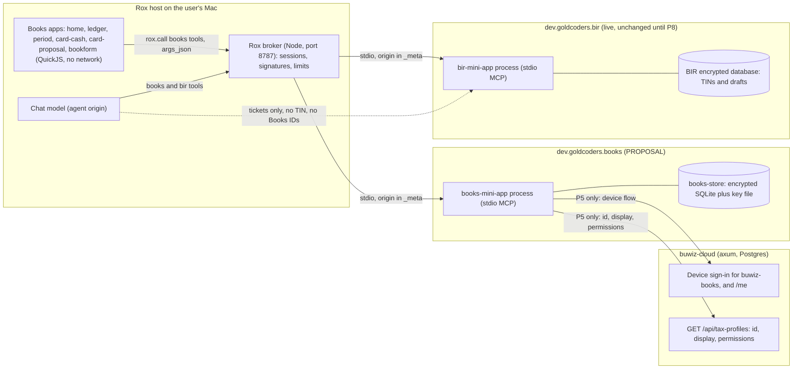
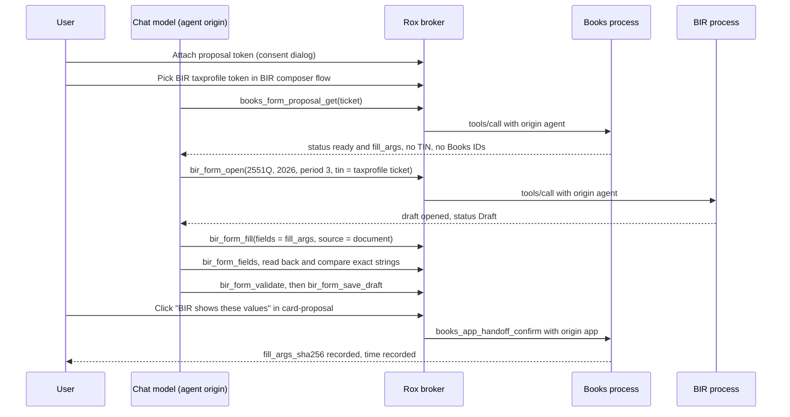
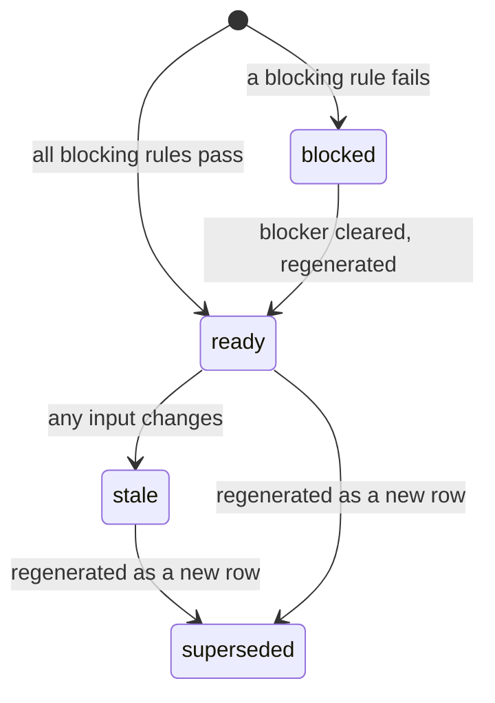

# 01 Architecture: Buwiz Books mini app (`dev.goldcoders.books`)

Status: recommendation, dated 2026-10-29. Writer: W3 (architecture and build plan).
Read next: [04 first slice](04-first-slice.md), [05 plan](05-implementation-plan.md), [06 tests](06-testing-plan.md), [07 decisions and blockers](07-decisions-and-blockers.md), [ADRs](adr/).

## How to read this file

| Label | Meaning |
|---|---|
| CONFIRMED | Seen in code, data or a primary source, and cited. |
| PARTIAL | Seen in part. The gap is named. |
| MISSING | Searched, method given. Absence is not proof. |
| UNKNOWN | Not established. Needs a check or an owner. |
| UNCONFIRMED | A claim with no primary source. Do not build on it. |
| INFERENCE | Reasoning from CONFIRMED facts. |
| PROPOSAL | A design choice for Books. Not built. Unmarked design statements are PROPOSAL. |
| [V] | Re-checked on disk on 2026-10-29 while writing this file. |
| canonical design | The design judgment of 2026-10-29 that these files follow. Its final decisions are restated in [07 section 1.3](07-decisions-and-blockers.md#13-design-decisions-w3-write-up-2026-10-29). Where it disagrees with the evidence, the evidence wins and [07 section 5](07-decisions-and-blockers.md#5-design-corrections) says so. |

Facts carry a label and a citation. Design choices are marked PROPOSAL. Section 3.3 is split into **Observed** and **Recommended** parts. Section 9 keeps observed constraints (9.1) apart from proposals (9.2 to 9.4).
Citations such as `[rox §5 stage 6]` point to the evidence traces in `../research/traces/`.

**Path roots.** Source paths are relative to the repo named in the sentence, or to the repo in section 1.2 that the path clearly belongs to. Bare `app/` or `server/` paths are in Rox (`/Volumes/goldcoders/Projects/rox`). `crates/bir-*` paths are in the live BIR tree (`/Volumes/goldcoders/reverse-engineer-ebir-forms/bir`). `src/lib/...` and `src/db/...` paths are in BK-TS (`/Volumes/goldcoders/OSS/buwiz-books`). `src/claims.rs`, `src/oauth.rs` and `migrations/0001_init.sql` are in buwiz-cloud (`/Volumes/goldcoders/buwiz-cloud`). `crates/bir-core/...` paths named with buwiz-forms or buwiz-oss are in those repos.

---

## 0. Summary

- Books is a new, separate Rox plugin, `dev.goldcoders.books` (PROPOSAL id). The owner decided Books is a separate service in its own repo. [decisions.md, owner 1]
- The ledger lives in an encrypted local store inside the Books process. There is no server database and no sync in MVP. [decisions.md, owner 2]
- Bookkeeping is universal. The Philippines tax layer is optional and is linked from a business. [decisions.md, owner 3]
- Books stores no TIN in any phase. BIR holds TINs. Books links to a buwiz-cloud tax profile only by its opaque `id`. [decisions.md, cloud contract; identity §2.4]
- In MVP, Books reaches BIR only through the chat model, using BIR tickets. Books never sends, submits, files, queues or pays. [rox §8; bir-shell §6; decisions.md, owner 5]
- Books is bookkeeping and accounting. It produces **accounting measures** with lineage. A thin **bridge** maps measures onto Forms **input** boxes. **Buwiz Forms / the BIR mini app** owns all compliance: elections, applicability, ATC selection, rates, tax due, thresholds, OSD, graduated tax, tax rounding, penalties and due dates. [owner correction 2026-10-29; ADR 0007]
- The first slice is the Q3 2026 sales measures and the Form 2551Q input boxes they feed, built from synthetic sales. It stops at a reviewable BIR draft in which Forms computes the tax. [04]
- Blockers that can stop work: cloud contract drift (B1), scratch BIR isolation (B2), the source label for hand-off (D3), and the 1701-MS election locks in Forms (B7). See [07](07-decisions-and-blockers.md).

### 0.1 Responsibilities: Books, the bridge, Forms

Binding owner decision O6 (2026-10-29), recorded in [ADR 0007](adr/0007-books-supplies-measures-forms-owns-compliance.md).

| Concern | Books (bookkeeping and accounting) | Bridge (Books to Forms inputs) | Buwiz Forms / BIR mini app (compliance) |
|---|---|---|---|
| Transactions, payroll facts, evidence | Records them, encrypted, local-first | Reads measures only | — |
| Accounting measures (gross sales; returns, allowances, discounts; net sales; cost of sales; other income; expenses by category; gross compensation and components; employee and employer contributions, separate; tax withheld as recorded by payroll; certificates received with status) | Computes them per business profile per period, with lineage ([measures catalogue](../data/measures.v1.json)) | Consumes them | — |
| Accounting basis (when income and expenses are recognized) | Book setting: cash (default) or accrual ([ADR 0008](adr/0008-cash-basis-by-default.md)); every proposal records it | — | Which basis a return needs (tax timing basis) |
| Which measure feeds which input box | — | Versioned mapping rules ([data/rules](../data/rules/)); input boxes only | Owns the box definitions (schema pins) |
| Taxpayer choices that select between boxes (8% or graduated; OSD or itemized) | Never stored | Reads them from the Forms draft (`form_context`); never decides | Owns them (tax profile, yearly election) |
| Elections, applicability, NIL returns, ATC selection | — | — | Owns |
| Rates, thresholds (VAT ₱3M, 8% eligibility, mixed income) | — | — | Owns |
| Tax due, OSD amount, graduated tax, totals, tax rounding | — | — | Owns |
| Due dates, overdue status, penalties | — | — | Owns |
| 1601-C item 17 non-taxable 13th-month split (annual cap) | Supplies year-to-date payroll | **The one input-level tax rule in the bridge** (labelled; open for the Forms owner) | May take it over |
| TINs, drafts, filing | Never | Never | BIR owns; the user submits in BIR |

---

## 1. Scope, evidence and repo state

### 1.1 In and out of scope (MVP)

| In | Out |
|---|---|
| Local ledger, COA preset, periods, void by reversal | Any server database or sync |
| PT (2551Q) proposal with lineage, rule sets and staleness | 1601-C and payroll (P6), 1701-MS (P7), 2550Q and VAT |
| Chat hand-off into a BIR 2551Q draft (model-mediated) | Any send, submit, file, queue or pay, in Books or BIR |
| Optional cloud link by opaque tax-profile `id` (P5) | Accountant access (P9), evidence and 2307 import (P4) |
| Synthetic data only | Real financial data, the live BIR database |

### 1.2 Repo state used for citations (observed)

| Short name | Path | HEAD (observed) | State | Note |
|---|---|---|---|---|
| BK-TS | `/Volumes/goldcoders/OSS/buwiz-books` | `1662ca3`, main [V] | 4 entries outside `src` (1 modified, 3 untracked) [V] | TypeScript reference only. Bun. |
| BK-NEW (this repo) | `/Volumes/goldcoders/buwiz-books` | no commits [V] | `research/` untracked | Target of this plan. |
| Rox | `/Volumes/goldcoders/Projects/rox` | `8453d53`, perf-parity [V] | clean [V] | Broker, SDK, trust file. |
| BIR (live) | `/Volumes/goldcoders/reverse-engineer-ebir-forms/bir` | `29ca915b`, rox-mini-app-round2 [V] | 2 entries [V] | VERSION `2.6.3` at `crates/bir-shell/src/mini_app/v1/manifest.rs:30` [V]. |
| buwiz-cloud | `/Volumes/goldcoders/buwiz-cloud` | `9f5ee16` on main [V], checked after 14:34 +0800 | clean [V] | The canonical design recorded `2887e50` on main with uncommitted work. That commit is now an ancestor, as are `6523fcf` (on `feat/submission-relay`, now merged) and `12d63e8`. See 07, Design corrections. |
| buwiz-server | `/Volumes/goldcoders/buwiz-server` | `417ec3a`, main [V] | clean [V] | Spin app. Not used by Books MVP. |
| buwiz-forms | `/Volumes/goldcoders/OSS/buwiz-forms` | `301f9a0f`, main [V] | clean, stale [V] | Pin `63267ca` is a commit in the local object store [V]. |
| buwiz-oss | `/Volumes/goldcoders/buwiz-oss` | `0f34106`, main [V] | 42 entries, dirty [V] | Cites into `form_2551q.rs` are working-tree text. |

### 1.3 Evidence index (research traces)

| Trace | File | Covers |
|---|---|---|
| rox | [../research/traces/rox.md](../research/traces/rox.md) | Rox host, broker, SDK, manifest rules, limits, consent, tests |
| bir-shell | [../research/traces/bir-shell.md](../research/traces/bir-shell.md) | BIR mini app, tickets, tools, cross-plugin limits, findings |
| bir | [../research/traces/bir.md](../research/traces/bir.md) | PH rules and form editions, cited by rule id (PT-, 8-, W-, D-, M-) |
| forms | [../research/traces/forms.md](../research/traces/forms.md) | Forms schemas, bir-mcp contract, gating |
| verify | [../research/traces/verify.md](../research/traces/verify.md) | Adversarial verdicts. Section 4 is the verified crosswalk. Governs conflicts. |
| books | [../research/traces/books.md](../research/traces/books.md) | Existing TypeScript ledger and tax code, with defects |
| sheets | [../research/traces/sheets.md](../research/traces/sheets.md) | Research workbook audit |
| identity | [../research/traces/identity.md](../research/traces/identity.md) | Accounts, TIN storage, tickets, passes |
| decisions | [../research/traces/decisions.md](../research/traces/decisions.md) | Binding owner and peer decisions |

---

## 2. User journey (plain language)

1. **Install.** The user connects apps and installs the signed `books` plugin. Rox asks once for the permissions. [A1]
2. **Create a book.** The user types a neutral label (D1). Setting country PH turns on the tax layer. The user applies the `philippines-smb` chart of accounts. Applying is idempotent (the BK-TS apply path is described as idempotent and non-destructive in its `CLAUDE.md`). [books §3b; BK-TS `src/lib/tax/ph-chart.ts`]
3. **Record activity.** The user posts sales and expenses. An unbalanced entry is refused with `unbalanced`. A mistake in an open period is fixed by a void, which posts a reversal. [A3, A4]
4. **Review return events.** A sales return, allowance, discount or credit note, or a reversal of an earlier period's sale, needs an acknowledgement (bookkeeping review). Elections (8% or graduated) are not set in Books: the user chooses them each year in the Forms tax profile (ADR 0007).
5. **See readiness.** The proposal card shows the 2026-Q3 sales measures and the 2551Q inputs they feed as `blocked` or `ready`. Blocking reasons come first, then warnings.
6. **Close the quarter.** In the period app, entries in the period become immutable and a snapshot payload is stored. Reopening needs a reason. [A7]
7. **Generate the proposal.** Generation is idempotent. Slice A values: net sales 200,000.00 for `txtATCAmt1`, with lineage. Books shows no tax, due date or overdue status: Forms computes the tax (6,000.00 at 3%) and owns the deadline. [A5]
8. **Hand off in chat.** The user attaches the Books `proposal` token (a Rox consent dialog). The user picks the BIR `taxprofile` token through BIR's own composer flow. The assistant reads the proposal, opens the BIR 2551Q draft, fills it once with `source: "document"`, reads it back, validates, and saves a draft. It never sends. [B1-B7]
9. **Confirm.** The user checks the BIR draft and clicks "BIR shows these values" in the proposal card. Books records `fill_args_sha256` and the time. The user submits in BIR, outside this design. [B5]
10. **Change after hand-off.** A ledger change, a reopen or a rule change marks the proposal stale. The assistant refuses to fill and says why. Regenerating creates a new proposal row. [B4]

**Failure paths**

| Situation | What happens | Evidence |
|---|---|---|
| BIR says a form is already open | The assistant asks the user to save or dismiss it. It does not retry. | forms §5 (`gate_form_lock`); bir-shell §4 B |
| A locked election box is refused | Books never writes item 13. | verify §3, §4 (item 13 lock) |
| 8% election year | Books output is unchanged; whether a 2551Q is required is Forms' decision. For 1701-MS the bridge reads the option from the Forms draft and maps net sales to IV.19. | ADR 0007; former D5 (handed to Forms) |
| Forms context missing (1701-MS tax option) | Proposal is `blocked` (`form_context_missing`). The bridge never defaults the choice. | `BRIDGE.FORM_CONTEXT_READ_ONLY` |
| BIR signed out | BIR refuses data verbs. The assistant tells the user to sign in to BIR first. | identity §1 item 3; `account_gate.rs:19, 63` (BIR, per identity) |

---

## 3. Components and processes

### 3.1 Components

| Component | Owner | Role | Status |
|---|---|---|---|
| Rox host and broker | Rox owner | Installs signed manifests, opens sessions, enforces permissions, limits and consent | CONFIRMED [rox §5] |
| Books apps (TSX) | Books | `home`, `ledger`, `period`, `card-cash`, `card-proposal`, `bookform`. Import only `nsh` SDK-1 names and `rox`. | PROPOSAL. Import rule CONFIRMED for BIR practice [rox §5 stage 5; bir-shell §2] |
| `books-mini-app` (Rust stdio MCP) | Books | Tools, reserved `rox.*` tools, JCS manifest, ticket store | PROPOSAL |
| `books-core`, `books-store` | Books | Measures, the bridge's mapping and money. Encrypted store. No compliance logic (ADR 0007). | PROPOSAL |
| BIR plugin `dev.goldcoders.bir` | BIR owner | Opens, fills, validates, saves drafts. Holds TINs. | CONFIRMED [bir-shell §3] |
| Forms schema pins | Forms owner | Field bindings for 2551Q, 1601-C, 1701-MS | CONFIRMED [verify §3] |
| buwiz-cloud | cloud session | Device sign-in. Clients `buwiz-desktop` and `buwiz-books` at `src/oauth.rs:21` [V]. `/me`, `/api/tax-profiles`. | CONFIRMED. Contract drift (B1). |
| buwiz-server | none | Not used by Books MVP | CONFIRMED [identity §1 item 2] |
| BK-TS | Books | Reference only: COA preset data and logic to golden-test. No import. | CONFIRMED [decisions.md, owner 4] |

### 3.2 Diagram: components and boundaries



### 3.3 Process model

**Observed**

- The broker spawns plugin processes from a stored command and args. Spawn env is stored in the broker database `[bir-shell §6, §8 item 10]`, at `server/src/v1/plugins.mjs:463` `[V]`. Spawn env therefore carries paths only.
- No sandbox was found for plugin processes. INFERENCE: the plugin has ordinary process rights `[rox §6-7; plugins.mjs:157]`.
- Restart backoff is `1, 2, 4, 8, 16, 32, 60` seconds (`plugins.mjs:34` [V]). The seventh restart within 10 minutes marks the plugin failed `[rox §5 stage 8]`.
- Limits: args 256 KiB, results 1 MiB, 8 calls in flight, 20 calls per second, 30 s timeout `[rox §5 stage 6]`.
- Manifest budget: 16 apps, 32 commands, 16 scopes, 8 routines, 64 tools per app, 256 KiB `[rox §7; bir-shell §1]`.
- `short` must be unique among enabled plugins, and every tool name must start with `<short>_` `[rox §7]`. The broker skips any tool whose name does not start with the short, and skips names already taken (`server/src/v1/agent.mjs:65` [V]). A skipped tool gives no error. INFERENCE: the Books build must check its tool names against the installed set.

**Recommended**

- Books spawns one process per plugin install. The process holds no secrets in env. Paths only.
- The store commits once per tool call. A restart then cannot leave a half-posted entry. This must be proven by test A8.
- Books pages entry lists at 200 rows. Proposals stay under 64 KiB. Both are well inside the limits above.

### 3.4 Sequence: chat hand-off (Slice B)



The model never calls `bir_form_send`. The audit log must show no call (B3).

---

## 4. Rox plugin manifest sketch

### 4.1 Observed manifest rules

- Top level: `protocol` `"1.0.0"`, `id` (reverse DNS, on the approved list), `short` matching `^[a-z][a-z0-9]{1,15}$`, `version` (semver), `title` 1 to 60 chars, `description` up to 300, `publisher` `{id, key_id, name}`, `signature` (ed25519 over JCS bytes without `signature`). Optional `commands`, `scopes`, `routines`, `apps`. `needs` must be absent or `[]` `[rox §7; SDK docs/manifest.md]`.
- Commands take `{name, args, description, resolve}`. Scopes take `{name, description, resolve, attach}`. `resolve` names a tool `[rox §7; SDK template/manifest.json]`.
- Apps take `id`, `title`, `description`, `entry` (`rox-app://<id>`), `mime` (`text/x-nsh-tsx`), `sdk` `"1"`, `fingerprint` (`sha256:<hex>`), `props` (JSON Schema subset), `placement` (`full`, `inline`, or both), `inline` size, and `permissions` `[rox §7]`.
- Permission keys: `tools` (up to 64), `open` `{apps, external}`, `attach` (up to 16 scope names), `pick_file`, `storage` (default 1 MiB, cap 10 MiB), `copy`, `preview`. Unknown keys are refused. A method that is not granted is absent, not failing `[rox §7; perms.rs]`.
- Always available: `rox.props`, `rox.app`, `rox.viewport`, `rox.fit`, `rox.ticket.title` `[rox §7]`.
- App-only tools carry `_meta["rox/audience"] = ["app"]`. The model never sees them `[server/src/v1/agent.mjs:47-52; BIR server.rs:1476 pattern]`.
- Apps have no network `[rox §5 stage 6]`.

### 4.2 Proposed manifest (sketch, all names PROPOSAL)

```json
{
  "protocol": "1.0.0",
  "id": "dev.goldcoders.books",
  "short": "books",
  "version": "0.1.0",
  "title": "Buwiz Books",
  "description": "Bookkeeping, with an optional Philippines tax layer.",
  "publisher": { "id": "dev.goldcoders", "key_id": "gc-2026-01", "name": "Goldcoders" },
  "commands": [
    { "name": "books", "args": "", "description": "Open Buwiz Books", "resolve": "books_resolve" }
  ],
  "scopes": [
    { "name": "book", "description": "A book by its neutral label", "resolve": "books_resolve", "attach": true },
    { "name": "proposal", "description": "A tax proposal by form and period", "resolve": "books_resolve", "attach": true }
  ],
  "routines": [],
  "apps": [
    { "id": "home", "placement": ["full", "inline"],
      "permissions": { "tools": ["books_status", "books_book_get", "books_period_summary"],
                       "open": { "apps": ["ledger", "period", "card-proposal"] },
                       "attach": ["book"], "storage": { "quota_bytes": 65536 } } },
    { "id": "ledger", "placement": ["full"],
      "permissions": { "tools": ["books_entry_list", "books_app_post_entry", "books_app_void_entry"] } },
    { "id": "period", "placement": ["full"],
      "permissions": { "tools": ["books_period_summary", "books_app_close_period", "books_app_reopen_period",
                                 "books_app_set_fact", "books_app_acknowledge", "books_app_record_election"] } },
    { "id": "card-cash", "placement": ["inline"],
      "permissions": { "tools": ["books_status", "books_period_summary"], "open": { "apps": ["home"] } } },
    { "id": "card-proposal", "placement": ["inline"],
      "permissions": { "tools": ["books_form_proposal_get", "books_proposal_generate",
                                 "books_app_handoff_confirm", "books_app_proposal_lineage"],
                       "open": { "apps": ["bookform", "home"] }, "attach": ["proposal"] } },
    { "id": "bookform", "placement": ["full"],
      "permissions": { "tools": ["books_form_proposal_get", "books_app_handoff_confirm"] } }
  ],
  "signature": "added by the signing step, never by hand"
}
```

Notes: the `commands`, `scopes` and `apps` entries follow the shapes CONFIRMED in the SDK template. The `storage` quota is a PROPOSAL. Books keeps UI preferences only. Each app also needs `fingerprint` and `inline` sizes, which the signing step and the app build fill in. Routines: none (D8).

**P0 as built (2026-10-29, `crates/books-mini-app`).**
- The generator writes the manifest with `books-mini-app manifest [--key-id <id>]`. The key id defaults to `gc-2026-01` for release (O8); tests pass `books-test-01`. The signed manifest is served through `BOOKS_V1_MANIFEST`, the way BIR uses `BIR_V1_MANIFEST`.
- Titles: the manifest is "Buwiz Books" and `home` is "Books".
- `home` is `["full", "inline"]`, so the stub is a card that `rox.fit` can size. It shows a label and a status with a book count only (RK-21).
- P0 has two tools, `books_status` and `books_resolve`, and the command `books`. The other apps, tools and scopes above arrive with the ledger (P1 and later).

### 4.3 Books tools and who may call them (PROPOSAL)

| Tool | Origin | Read or write | Notes |
|---|---|---|---|
| `books_status` | agent, app | read | Setup and versions. No amounts. |
| `books_book_get(ticket)` | agent, app | read | Neutral label and counts. |
| `books_entry_list(ticket, period, page)` | agent, app | read | Memo excluded. 200 rows per page. |
| `books_period_summary(ticket, period)` | agent, app | read | Totals as decimal text. |
| `books_form_proposal_get(ticket)` | agent, app | read | `fill_args` only when status is `ready`. |
| `books_resolve` | resolve | read | Command and scope resolution only. |
| `books_entry_draft(client_request_id, ...)` | agent | write, drafts only | Posting is app-only (D16). |
| `books_proposal_generate(client_request_id, period, form)` | agent, app | write, idempotent | Repeats return the stored row (A9). |
| `books_app_post_entry`, `_void_entry`, `_close_period`, `_reopen_period`, `_set_fact`, `_acknowledge`, `_record_election`, `_handoff_confirm` | app only | write | Each needs a user click. |
| `books_app_proposal_lineage` | app only | read | Lineage is never shown to the model (D11). |
| `books_app_evidence_add` (P4) | app only | write | Uses `pick_file`. |

### 4.4 Who enforces what

| Check | Enforced by | Evidence |
|---|---|---|
| Session certificate, Ks signature, nonce, 60 s timestamp, permission digest, tool in `permissions.tools`, rate, timeout | Rox broker | `[rox §5 stage 6]`; `server/src/v1/sessions.mjs:190-232` (per rox §5 stage 6, not re-read for this file) |
| App calls only its own tools | Rox host (`permission_denied` before the broker) | `app/src/mini_v1/bridge.rs:452-457` (per rox §5 stage 6) |
| Origin per call (`app`, `agent`, `resolve`, `routine`) | Books, from `_meta["rox/caller"]` | BIR pattern: `server.rs:554-595`, bir-shell §3 |
| App-only tools refused for other origins | Books | BIR pattern: `server.rs:1191-1197` [V] |
| Certified open required for app origin | Books | BIR pattern: bir-shell §3 |
| Output scrub for TIN-shaped text | Books (its own scrubber) | Rox has no broker-side scrubber `[bir-shell §8 item 7 MISSING]`; BIR's text scrub is partial `[bir-shell §8 item 6]` |

### 4.5 Cross-plugin reach

| Action | Allowed | Evidence |
|---|---|---|
| Books app calls a BIR tool | No | Rox `rox.call` reaches own tools only `[rox §5 stage 6; bir-shell §6]` |
| Books app opens a BIR app | No | Same-plugin opens only `[bir-shell §6; spec §7.5]` |
| Books app attaches a BIR token | No | `[bir-shell §6, spec §7.6]` |
| Model calls both plugins in one chat | Yes | Agent origin sees both plugins' tools `[rox §5 stage 1; agent.mjs]` |
| Books routine reads BIR | Possible via `reads`, approved once. Not used (D8). | `[bir-shell §6]` |
| User clicks a `rox://app` link into BIR with a BIR ticket | Yes, with consent every time. Books cannot mint BIR tickets. | `[bir-shell §6]`; `tickets.rs:186-227` [V on 186] |

---

## 5. Identity and permissions

### 5.1 Observed identity facts

- Rox has no user identity. The plugin key is one ed25519 seed per install. Each app open gets a session certificate and each call is signed by the session key `[rox §5 stage 2-3; identity §2.1]`.
- BIR's identity is a Buwiz account signed in through device flow. Every BIR data verb is refused while signed out `[identity §1 item 3]`.
- buwiz-cloud v1: one account, no organizations, no workspaces `[decisions.md, cloud]`. A tax profile is an approved TIN. "Approved" means non-empty `permissions` `[decisions.md, cloud]`.
- At 9f5ee16, buwiz-cloud `GET /api/tax-profiles` returned, per profile: `id`, `tin`, `tin_masked`, `registered_name`, `activated_at`, `permissions` (`src/claims.rs:410-433`) [V]. buwiz-server PR #4 (head `42190a5`, merged 2026-10-29 07:01 UTC) changes a `books`-scope token's response to `{id, tin_masked, registered_name, activated_at, permissions:["profile.view"]}`. See B1.
- The live permission list is shared by all clients and includes `filing.submit` (`src/claims.rs:27`) [V].
- Live buwiz-cloud at 9f5ee16 also has grant scopes `app` (the Buwiz apps, including `buwiz-books`) and `mcp` (AI agents), and a `POST /mcp` endpoint with read-only tools (`src/oauth.rs:213-214`; `src/agents.rs`; `src/mcp.rs`). `mcp` tokens reach `GET /api/tax-profiles` and `list_tax_profiles`, and both return `tin` (`src/claims.rs:410-433`; `src/mcp.rs:156-158`). The decisions contract does not cover this (`docs/00-findings.md` F-50). Fixed in buwiz-server PR #4 (head `42190a5`, merged 2026-10-29 07:01 UTC): `mcp` tokens get `tin_masked` only, and `buwiz-books` gets its own `books` scope instead of `app`.

### 5.2 Human identity in Books MVP

The local OS user, plus an optional buwiz cloud account from P5 (D19). There is no Books user table in MVP.

### 5.3 Identity and secret table (PROPOSAL unless marked)

| ID or secret | Minted by | Stored in | May travel to | Must never appear in | Status |
|---|---|---|---|---|---|
| `business_id` (UUIDv7) | Books, on book create | `business` table | Books process only | Model output, Rox props or links, titles, logs | PROPOSAL |
| Books ticket `tkt_` plus 26 Crockford characters (130 random bits) | Books ticket store | `ticket` table (subject map) | Model, Rox tokens, app props (up to 1024 bytes) | Titles, TINs, BIR values | Grammar CONFIRMED for BIR `[identity §2.8]`; Books reuses it |
| Rox token `@books:book:...`, `@books:proposal:...` | Rox, from Books resolve | Rox `mini-v1.json` attachments | Chat | n/a | Mechanism CONFIRMED `[rox §5 stage 9]` |
| Book label (neutral) | User | `business` table; Rox title | Rox title (clear text) | Legal names, amounts | D1; Rox keeps titles in clear text `[rox §10]` |
| `entry_id`, `line_id`, `proposal_id` (UUIDv7) | Books | Books store | Books; model only through tickets | Model output (unless D11 changes) | PROPOSAL |
| `client_request_id` | Caller | `idempotency` table | Tool args | n/a | PROPOSAL (A9; canonical R-18) |
| Plugin key (ed25519, per install) | Rox at `rox.provision` | Keychain item `dev.goldcoders.rox.plugin-key` | Rox and plugin | Env, argv, repo | CONFIRMED `[rox §5 stage 2]` |
| Session certificate and Ks (per open, up to 8 h) | Rox and plugin | Memory | Broker | Any store, logs | CONFIRMED `[rox §5 stage 3]` |
| Publisher key `gc-2026-01` (private) | Owner | Keychain | Signing tool only | Repo, env, logs | CONFIRMED `[rox §5 stage 2]`. Books reuses it at release (owner decision O8, D9). Tests use a throwaway key under a test key id. |
| `manifest_sha256` | Signing step | Rox install record | Conformance evidence | n/a | CONFIRMED `[rox §5 stage 2]` |
| Books DB key file | Owner, at setup | File beside the store, mode 0600, outside the repo | Books process, by path | Env values, git, unencrypted backups | PROPOSAL (D2) |
| Cloud refresh token (rotating) | Cloud device flow | Books process only (0600 file or Keychain) | Cloud token endpoint | Env, argv, logs | PROPOSAL (P5) |
| Device code and user code | Cloud | Memory | User (display) | Any store | CONFIRMED `[cloud README: device flow]` |
| Cloud `user_id` (from `/me`) | Cloud | Optional, hashed | None | Model, props | PROPOSAL |
| Cloud tax-profile `id` (opaque UUID, never reused) | Cloud, on approval | `business.cloud_tax_profile_id` | Cloud API only | Links, model output, anything derived from TIN | Contract `[decisions.md, cloud]` |
| Cloud `tin_masked` | Cloud | UI cache only | UI; model may see the masked form | n/a | Contract (P-C3, revised 2026-10-29) |
| Cloud `permissions[]` | Cloud | Boolean "approved" only | n/a | Books never relies on `filing.submit`; a `books` token gets `profile.view` only | Contract; B1 |
| TIN (9-digit root, 5-digit branch) | User, with BIR and cloud | BIR encrypted DB; cloud `tin_claims.tin_root` plaintext `migrations/0001_init.sql:79` [V] | BIR only, through ticket expansion | Books store, logs, props, links, model context, titles | CONFIRMED remnants `[identity §2.4]` |
| BIR tickets (`tkt_`: taxprofile, return) | BIR only | BIR settings row (`tickets.rs:28`) | Chat; model args to BIR tools | Books store and outputs | CONFIRMED `[bir-shell §3]` |
| BIR draft identity (code, year, period, TIN) | BIR | BIR `form_drafts` | BIR tools | Books (Books keeps `fill_args_sha256` only) | CONFIRMED `[forms §5]` |
| `fill_args_sha256` | Books | `handoff` table | Books | n/a | PROPOSAL (B5) |
| Payor TIN on a 2307 certificate | Payor | HMAC plus masked display only | n/a | Plaintext anywhere | PROPOSAL (D23). BK-TS keeps plaintext `payorTin` `[books §2; tax-certificates.ts:47]` |
| Evidence id and sha256 | Books | Encrypted blob | Model gets sha256 and kind only | OCR text by default | PROPOSAL (R-23) |
| Rox `open_id`, origin, timestamp | Rox | n/a | Books, via `_meta["rox/caller"]` | Memo-bearing logs | CONFIRMED `[rox §5 stage 6]` |

### 5.4 Ticket rules (PROPOSAL)

- Grammar: `^tkt_[0-9A-HJKMNP-TV-Z]{26}$` `[identity §2.8]`.
- Subject kinds for Books: `book`, `entry`, `proposal`, `period`.
- Tickets are capabilities. Books supports revocation. BIR does not `[identity §2.7, MISSING in BIR]`.
- A ticket in a link must keep props under 1024 bytes `[rox §7]`.
- Titles carry the neutral label only. No amounts, TINs or legal names by default (D1; `[rox §10]`).

### 5.5 Who may do what

| Caller | Allowed | Not allowed |
|---|---|---|
| Model (agent) | Reads listed in 4.3. Create drafts (`books_entry_draft`). Generate proposals (idempotent). | Post, void, close, reopen, set facts, acknowledge, record elections, hand-off confirm, lineage. |
| App (after a user click) | The app's listed tools. Each write needs a click. | Any tool outside the app's permissions. |
| Resolve | `books_resolve` only. | Writes. |
| Routine | Nothing in MVP (D8). | Everything. |

Basis: D16 and D20, and BIR's `is_app_only` convention `[bir-shell §3]`.

### 5.6 Consent points

| Action | Consent | Evidence |
|---|---|---|
| Attach a `book` or `proposal` token | Dialog | `[rox §5 stage 9]` |
| Attach a BIR `taxprofile` token | The user attaches it in BIR's own flow. Books cannot attach it. | `[bir-shell §6]` |
| `rox.open` a same-plugin app | None | `[rox §5 stage 9]` |
| `rox.open` an external URL | Dialog | `[rox §5 stage 9]` |
| A `rox://app` link from outside | Dialog every time | `[bir-shell §6, spec §9.7]` |
| `rox.pickFile` (evidence, P4) | Native file dialog | `[rox §5 stage 9]` |
| Pin, typed command | None | `[rox §5 stage 9]` |
| Inline card mount | None when the publisher is first-party. Books uses publisher `dev.goldcoders` (decided, O8), so its inline cards mount at once. | `plugins.mjs:32, 737` [V]; D9, D22 |

Because inline cards mount without a click, Books shows only counts and status on inline cards until the owner accepts more (item 22).

### 5.7 Cloud link (P5, PROPOSAL)

- Device sign-in as client `buwiz-books`, scope `books` (registered at `src/oauth.rs:21` [V]): `POST /oauth/device/code`, then poll `POST /oauth/token`. Refresh rotates, and reusing an old refresh token revokes the whole grant, so Books writes the new refresh token to its store before it uses the new access token (P-C4).
- `GET /me` for the user id, if needed.
- `GET /api/tax-profiles`: Books reads `id`, `tin_masked`, `registered_name` and `permissions` only, and ignores other fields (the cloud may add non-sensitive ones, P-C8). It refuses any response that carries a `tin` field or other TIN-shaped fields. It never relies on `filing.submit`.
- The link is stored by `id`. If an approval is withdrawn, the id leaves the list (the query filters `status = 'approved'`, `src/claims.rs:418` [V]). Books then marks the link inactive and refuses fills.
- Blocker B1 must close first. At 9f5ee16 the code returned `tin` to every token and gave `buwiz-books` the `app` scope. Fixed by buwiz-server PR #4 (head `42190a5`, merged 2026-10-29 07:01 UTC).

---

## 6. Data ownership and local-first store

### 6.1 Who owns what

| Data | Owner | Where | Books may store? | Evidence |
|---|---|---|---|---|
| Business label and country | Books | `books-store` | Yes | decisions.md owner 1, 3 |
| Ledger: accounts, entries, lines, periods | Books | `books-store`, encrypted | Yes | decisions.md owner 2 |
| Elections, tax facts, rates, thresholds, due dates | Forms (tax profile and form rules) | Forms / BIR | No. The bridge reads the choices it needs from the Forms draft (ADR 0007). | Owner O6 |
| Measures catalogue and mapping rules | Books (data), Forms (schema pins) | `data/` in this repo, plus `books-store` | Yes | ADR 0007; verify §3 |
| TIN, COR, RDO and branch facts | BIR | BIR encrypted DB | No | identity §2.3-2.4 |
| Cloud tax-profile `id` | Cloud | Books store | Yes, id only | decisions.md cloud; ADR 0003 |
| Draft values in BIR | BIR | BIR `form_drafts` | No. Books keeps `fill_args_sha256` only. | bir-shell §4 |
| Evidence files (P4) | Books | Encrypted blob | Yes. Model sees sha256 and kind. | Canonical design |

### 6.2 Store design (PROPOSAL)

- **Engine.** SQLite with SQLCipher-compatible encryption, as BIR does `[bir-shell §3: SQLCipher AES-256]`. The crate and its build are UNKNOWN until P1 proves them.
- **Key.** A key file, mode 0600, outside the repo. Its path comes from env (`BOOKS_DB_KEY_FILE`, PROPOSAL). No Keychain in MVP. This follows the BIR pattern `BIR_DB_KEY_FILE` with `BIR_NO_KEYCHAIN=1` `[bir-shell §3; rox §6]` and the decisions.md note to avoid Keychain in rebuilt binaries.
- **Refusals.** Refuse to open on a wrong key, and leave no partial state (A8). Refuse on `cipher_version` mismatch, because a mismatch can mean silent non-encryption.
- **Metadata.** A `meta` table holds `schema_version`, `cipher_version`, `store_id` and `created_at`.
- **Durability.** One transaction per tool call. A kill between calls must not lose a committed call (A8).
- **Backup.** The encrypted file and the key file are backed up separately. Books warns the user at setup. Key custody default is the key file now. A passphrase-wrapped key (Argon2id) with a backup prompt is required before release (D2).
- **Loss.** Losing the key file means losing the ledger. No recovery is designed. This is a release blocker, not an MVP blocker.
- **Uninstall.** Keep data by default (D10). Rox's uninstall cascade removes pins, attachments and rox storage. It does not remove the Books store `[rox §5 stage 8]`. Books' `rox.uninstall` handler decides.
- **Path.** The data directory is PROPOSAL. Use `~/Library/Application Support/` with a Books-owned folder, passed by env as a path.

### 6.3 Data model (PROPOSAL)

| Table | Key columns | Notes |
|---|---|---|
| `meta` | key, value | `schema_version`, `cipher_version`, `store_id` |
| `business` | `business_id` PK, label, country, tax_layer, coa_preset, coa_preset_version, `accounting_basis` (`cash` default, or `accrual`), `cloud_tax_profile_id` NULL | No TIN column. The basis changes only from the start of a year with no posted entries (ADR 0008). |
| `coa_account` | `account_id` PK, business_id, key, number, name, type, subtype, parent_id, active | Unique (business, key) and (business, number). Types per BK-TS `account-constants.ts:9-18` `[books §2]` |
| `category` | `category_id` PK, business_id, key, label, account_key, default_line_attributes JSON, applies_if JSON | See section 7. `applies_if` may read the linked tax profile's registered-forms list as a hint, never an election. |
| `return_ack` | entry_id, business_id, acknowledged_at, reason | Bookkeeping review of a return event (`GATE.RETURNS_ACK`). Replaces the `tax_fact` and `election_event` tables, removed by ADR 0007. |
| `period` | `period_key` PK (for example `2026-Q3`), business_id, kind, start_date, end_date, status, closed_at, snapshot_sha256 | Per tax period (not the org-wide date) |
| `period_event` | event_id, business_id, period_key, event (`close` or `reopen`), reason, at | Reason text. No memo. |
| `journal_entry` | `entry_id` PK, business_id, `entry_date` DATE, status (`draft`, `posted`, `voided`), reverses_entry_id NULL, memo_enc, `client_request_id` UNIQUE, posted_at | Dates are calendar days in Asia/Manila. On a cash-basis book the entry date is the day money moved. |
| `journal_line` | `line_id` PK, entry_id, line_no, account_id, debit_centavos INTEGER ≥ 0, credit_centavos INTEGER ≥ 0, measure_side NULL, income_class, contra_kind NULL, person_scope, party_ref NULL (opaque), comp_component NULL, contribution_side, contribution_scheme NULL, credit_kind, certificate_atc NULL (evidence), certificate_status NULL, revision | A line is debit or credit, not both. Entry must balance at post. Accounting facts only (ADR 0007). A cash-basis book refuses trade receivable and payable accounts (ADR 0008). |
| `evidence` (P4) | evidence_id, business_id, sha256, mime, bytes, blob_enc, redaction_state, ocr_text_enc NULL | — |
| `certificate` (P4) | cert_id, business_id, kind (`2307`, `2306`, `2316`), cert_hmac, payor_hmac, payor_masked, certificate_atc (as printed; evidence), `period_start` DATE, `period_end` DATE, income_payment_centavos, tax_withheld_centavos, status (`received`, `pending`, `lost`, `disputed`), evidence_id, posted_entry_id NULL | Only `received` counts in a certificate measure (DD-18) |
| `rule_set` | `rule_set_id` PK (for example `2551Q-v2018-r2`), form_code, edition, schema_sha256, measures_catalog, status, effective_from, effective_to NULL, citation_ids | Immutable once a proposal references it |
| `rule_mapping` | mapping_id PK, rule_set_id, target_key, measures JSON, aggregation, period_basis, person_scope, form_context JSON NULL, review_status, citation_id | Input keys only (ADR 0007). No rate table. |
| `citation` | citation_id PK, source, locator, status, source_sha256, retrieved_on | — |
| `proposal` | proposal_id PK, business_id, form_code, tax_period_key, rule_set_id, schema_sha256, form_context JSON, inputs_hash, output_sha256, status (`ready`, `blocked`, `stale`, `superseded`), blocking JSON, warnings JSON, measures JSON, fill_args JSON, reference_values JSON, client_request_id UNIQUE, created_at | Values are decimal text. No tax due, rate or due date. |
| `proposal_lineage` | proposal_id, field_key, line_id, contribution_centavos | App-only read |
| `handoff` | handoff_id, proposal_id, form_code, fill_args_sha256, confirmed_at, status | Written only after a user click |
| `ticket` | `ticket` PK (`tkt_...`), subject_kind, subject_id, label, created_at, revoked_at NULL | Revocation supported |
| `idempotency` | `client_request_id` PK, tool, request_sha256, result_json, created_at | — |
| `audit_event` | event_id, at, origin, tool, subject_kind, subject_id, outcome | No memo, no TIN, no amounts beyond counts |

Migration source of truth: `crates/books-store/migrations/0001_init.sql` (P1).

### 6.4 Money and time

- Money is `i64` centavos. Use `i128` for intermediate products. Overflow is checked.
- JSON carries decimal text with exactly two places, for example `"200000.00"`. Input with more than two decimals is refused.
- Negative values stay negative. Nothing is clamped to zero. An overpayment is a separate signed line `[sheets §6 item 15]`.
- Measures are exact sums of centavos. Books applies no rate and rounds nothing (ADR 0007).
- Books code has no floats (CI check, PROPOSAL). BIR's Forms path is f64 at the input (`crates/bir-core/src/forms/form_2551q.rs:1467` `cents(value: f64) -> i64` [V]). That is Forms' rounding concern (section 2.2 of 07).
- Dates are DATE values in Asia/Manila. The book's accounting basis decides what an entry date means ([ADR 0008](adr/0008-cash-basis-by-default.md)): on a cash-basis book (the default) it is the day money was received or paid; on an accrual book it is the invoice or bill date. Measures read the entry date on either basis. Which basis a return needs is Forms'.
- BK-TS shows the two money styles in use `[books §4i]`. Books uses only centavos.

### 6.5 Local-first rules (PROPOSAL)

- Closed entries are immutable. A reopen needs a reason. It writes `period_event` and marks dependent proposals stale.
- Locks are per tax period. BK-TS uses one org-wide `closedThrough` date that can move backward `[books §1 item 9; auth.ts:92 [V]]`. Books does not port that.
- Every write takes `client_request_id`. A repeat returns the stored result `[books §1 items 2, 6]`.
- The audit log holds no memo text, no TIN and no amounts beyond counts.

### 6.6 Later sync (P9)

Not designed. Constraints now: any sync carries encrypted entries only, never a TIN, and needs a grant model (D15). Sync is not in MVP (owner 2).

---

## 7. Accounting measures, the bridge and proposals

Superseded by ADR-0007 (2026-10-29): the earlier version of this section held tax attributes, rate rows, an 8% block and a PT rounding rule. It is replaced below; the old text is in git history and the rates are in [research/handoff-to-forms/](../research/handoff-to-forms/).

### 7.1 Five layers

| Layer | What it holds | Who sets it | Example |
|---|---|---|---|
| 1. Account | Where money sits in the books. Number and type. **No form meaning.** | COA preset | 41000 Sales of services |
| 2. Category | A user-facing grouping, with default line attributes. Suggestions may use the linked tax profile's registered-forms list as a hint, never an election. | Preset, then user | "Sales of services" defaults to `income_class=business_sales` |
| 3. Line attributes | Accounting and evidence facts on each journal line | User at posting, defaulted from category | `income_class=contra_sales`, `contra_kind=return` |
| 4. Measures | Accounting measures per business profile per period, with lineage | Books, from layer 3 ([measures catalogue](../data/measures.v1.json)) | `net_sales` 2026-Q3 = 290,000.00 |
| 5. Mapping rules | Versioned rules: measure → Forms input key, with optional Forms-context condition | Bridge rule set, bound to a pinned Forms schema | `2551Q.S1.1.base`: `net_sales` → `txtATCAmt1` |

Evidence for layers 1 and 3: an account like `salaries` (61100) feeds 1601-C II.14 and 1701-MS IV.10A, and `refunds_and_discounts` (49000) feeds the 2551Q base and 1701-MS IV.6 and IV.19 `[sheets §8 item 1]`. BK-TS accounts have no tax attribute `[books §1 item 3, §2]`. Full attribute list: [docs/02-categories-and-attributes.md](02-categories-and-attributes.md). ADRs: [0006](adr/0006-tax-meaning-on-lines-not-accounts.md), [0007](adr/0007-books-supplies-measures-forms-owns-compliance.md).

### 7.2 Attributes (MVP subset)

| Attribute | Values | Notes |
|---|---|---|
| `income_class` | `business_sales`, `contra_sales`, `non_operating_income`, `cost_of_sales`, `operating_expense`, `none` | Statement bucket |
| `contra_kind` | `return`, `allowance`, `discount` | Required on `contra_sales`; three separate measures |
| `measure_side` | `debit`, `credit` | Which side is positive for the line's measure |
| `person_scope` | `self`; spouse refused by the bridge in MVP | `employee` (P6), `payor` (P4) |
| `comp_component`, `contribution_side`, `contribution_scheme` | payroll facts | Employee and employer shares are separate measures |
| `credit_kind`, `certificate_atc`, `certificate_status` | evidence facts printed on a received certificate | `certificate_atc` is evidence, never an ATC choice |

Removed by ADR 0007: `tax_type`, `atc` (as a choice), `treatment`, `regime`, `vat_status`, `returns_state`, `election_event`.

### 7.3 Mapping schema (PROPOSAL)

Rule set header (r2):

```json
{"rule_set_id":"2551Q-v2018-r2","form_code":"2551Q","edition":"January 2018 (ENCS)",
 "schema_sha256":"a206416cabb09c5e1e0ebedf9f7ac635a46856a139ffbbde5f7be88f89005788",
 "measures_catalog":"measures-v1","version":2}
```

Mapping example (2551Q):

```json
{"id":"2551Q.S1.1.base","mode":"fill","target_key":"txtATCAmt1","measures":["net_sales"],
 "aggregation":"sum","period_basis":"quarter","person_scope":"taxpayer","row":1,
 "review":{"status":"open","note":"net or gross sales for row 1 is a mapping question for tax review (former D20)"}}
```

Mapping with a Forms-context condition (1701-MS). The bridge reads `/taxpayer/tax_option` from the Forms draft; it never decides it:

```json
{"id":"1701MS.IV.19","mode":"fill","target_key":"frm1701MS:txtSalesRevenuesFeesANo19a",
 "measures":["net_sales"],"form_context":[{"read":"/taxpayer/tax_option","equals":"eight_percent"}]}
```

For computed, locked and not_fillable boxes the rule set keeps no rule, only a `not_mapped` pointer with `owner: forms` (or profile, user, identity, prior_filing). The ATC (`schedule_1.0.atc`) is Forms'.

### 7.4 Versioning and staleness

- A rule set is immutable once a proposal references it. A change makes a new `rule_set_id`.
- Recomputing an old period under a corrected mapping creates a new proposal row. Nothing is overwritten.
- A proposal goes stale when any of these change: a line revision, an acknowledgement, the Forms context it read, the rule set, the measures catalogue, the crosswalk or schema hash, or a period reopen. `inputs_hash` covers all of them.
- Identical inputs give an identical `output_sha256`. A test proves it.

State of a proposal:



### 7.5 Edge cases

| Case | Rule | Status |
|---|---|---|
| Returns, allowances, discounts, credit notes | Separate measures. A return event holds mappings that read sales measures until acknowledged (`GATE.RETURNS_ACK`). Which measure feeds a box is a mapping rule. | Mapping for 2551Q row 1 open for tax review (former D20) |
| Employee and employer shares | Separate measures. 1601-C item 19 takes the employee measure only. | RR CONFIRMED `[bir §3.4 item 19]`. Statute UNVERIFIED. |
| PT and IT certificates | Separate measures (`credit_kind` printed on the certificate). One certificate feeds one form. A 2306 never counts. | CONFIRMED `[bir W-2 to W-4]`. Routing INFERENCE `[bir W-3]`. |
| Spouse | Measured, refused by the bridge in MVP | PROPOSAL |
| Taxpayer choices (8%, OSD) | Read from the Forms draft; a missing value blocks | DD-28 |
| 13th-month non-taxable part | The one input-level tax rule in the bridge (cap per employee per year) | DD-29, open for the Forms owner |
| Negatives | Measures keep their sign. A negative sales measure is not proposed for a box (`negative_measure`). No clamp. | BK-TS clamps in one sheet `[sheets §6 item 15]`. Books does not. |
| Recognition period | The entry date in Asia/Manila, which the book's basis sets: cash (default) posts on the day money moves, accrual at invoice or bill. Certificates use their own period fields. | Decided: [ADR 0008](adr/0008-cash-basis-by-default.md) (O7) |
| Rates, rounding, 8% and 2551Q, penalties, overdue | Not in Books | Handed to Forms (07 section 2.2) |
| Void in an open period | See section 7.6. | Open question Q-1 (07) |

### 7.6 Void rule (PROPOSAL, open question Q-1)

The canonical design says a void posts a reversal dated like the original entry (A4). It does not say whether the original stays `posted` or becomes `voided`. The two readings give the same Slice A result (200,000.00):

- **Reading 1 (recommended).** The original becomes `voided`. Measures skip voided entries and skip reversal entries. The ledger keeps both, and both balance.
- **Reading 2.** The original stays `posted`. The reversal is `posted`. Measures sum both, so they net to zero.

The two readings differ in lineage shape. Under Reading 1 the lineage omits the voided sale and its reversal. Under Reading 2 it lists both, netting to zero. Test A4 must pass either way. Test A5 (lineage) is written for Reading 1 and must be adjusted if Reading 2 is chosen. Pick one before P1 exit. A reversal dated in a later period is a return event. It holds the next proposal until acknowledged (canonical item 15). It never changes a closed period.

### 7.7 Worked example (synthetic golden data)

Workbook worked example, Q3 2026: gross sales 300,000.00, returns 10,000.00, net sales 290,000.00 → `txtATCAmt1` = 290,000.00 (mapping uses net sales). September payroll: gross compensation 42,000.00, de minimis 2,000.00, employee contributions 2,000.00 → `frm1601c:txtTax19`; the employer share (1,500.00) never reaches item 19. Annual: net sales 1,190,000.00; graduated (read from Forms) → IV.5 1,200,000.00 and IV.6 10,000.00; 8% (read from Forms) → IV.19 1,190,000.00.

Slice A (after the void): net sales 200,000.00.

Forms' outputs for the same inputs (2551Q tax 8,700.00 at 3%; Slice A 6,000.00; 1701-MS OSD 476,000.00 and tax 85,300.00) are recorded only as `expected_forms_computed` documentation in `fixtures/vectors/` and are never asserted against Books code.

---

## 8. Offline behaviour and errors

### 8.1 Offline

- Books works without a network connection. Sign-in is optional (D19).
- Cloud calls exist only in P5.
- BIR needs its own Buwiz sign-in before its data verbs answer `[identity §1 item 3]`. Books still works when BIR is signed out.

### 8.2 Error and recovery table

| Situation | What the user sees | What Books does | Evidence |
|---|---|---|---|
| Books process restarts | "Reconnecting", then the app reopens | Commits are per call. No half state. | `[rox §5 stage 8]`; A8 |
| Plugin fails (7 restarts in 10 minutes) | Plugin shown as failed | Nothing is lost. The user re-enables it. | `[rox §5 stage 8]` |
| Call timeout (30 s) | Error message | Books retries only with the same `client_request_id` | `[rox §5 stage 6]`; A9 |
| Permission denied at Rox | Refusal | Treat as refusal. Never branch on the code. | `bridge.rs:457-459` [V on 457]; A12 |
| Plugin-side denial | Refusal, arrives as `tool_error` | Treat as refusal. Never branch on the code. | `sessions.mjs:300` [V]; A12. INFERENCE: spec intends `permission_denied`. |
| Rate limited (20 per second) | Retry later | Back off | `[rox §5 stage 6]` |
| Result over 64 KiB | Page 2 | Page at 200 rows | A13 |
| Unbalanced entry | Refused with `unbalanced` | Nothing stored | A3 |
| Wrong key file | Refuses to open | No partial state | A8 |
| `cipher_version` mismatch | Refuses to open | No write | Store design, 6.2 |
| BIR signed out | Assistant says so and stops | No fill | `[identity §1 item 3]` |
| Stale proposal | Assistant refuses to fill, and says why | No fill | B4 |
| BIR "form already open" | Assistant asks the user to save or dismiss | No retry | `[forms §5]` |
| Cloud approval withdrawn | Link shows inactive | No fill | `[claims.rs:418]` [V] |

---

## 9. Connection to Forms (BIR)

### 9.1 Observed constraints

- **Fill keys.** The fill tool accepts exact official keys with the `frm<Form>:` prefix (for example `frm2551Qv2018:txt15`), or typed aliases for 2551Q and 1601-C. Bare `txt15` is rejected. For 2551Q and 1601-C, one bad key fails the whole call `[verify §1 item 1; §3]`.
- **Accepted typed aliases.** `txtATCAmt1` (bare official key) for schedule 1 row 1 taxable amount, `schedule_1.0.taxable_amount`, and `schedule_1.0.atc` for the ATC `[verify §2 item 23; §4; forms §10]`.
- **Locks.** Election and identity locks are refused. 1701-MS items 12 and 17 and `taxCodeDropdown` II015-II017 have no lock `[verify §1 item 3, §2 item 10; forms §5]`.
- **Source enum.** `profile`, `past_return`, `document`, `ai`. The default is `ai`. `user` is accepted only with `from_card: true`. Live: enum at `crates/bir-mcp/src/tools.rs:309`, schema default at 310, code default at 547 [V].
- **Provenance is session-only.** It is reset on open and never persisted `[bir-shell §4; §8 item 3; crates/bir-shell/src/agent/session.rs:55, 526 [V]]`.
- **Send tool.** `bir_form_send` is declared in the live tool list at `crates/bir-mcp/src/tools.rs:174-175` [V]. The live send path requires a standing send grant. Without it the result is `approval_required` and nothing is queued `[crates/bir-shell/src/agent/session.rs:1388-1400 [V]]`. Standing grants have no expiry `[bir-shell §8 item 1]`.
- **Test-only guard.** In the live tree, the `banned()` name guard that the buwiz-forms checkout shows at `tools.rs:539-552` is inside `#[cfg(test)]` (`tools.rs:551`, `:629` [V]). It is not a production guard. Books must not rely on it.
- **Draft identity.** `(code, year, period, tin)`. Quarterly periods are 1 to 4 `[forms §5]`.
- **One form at a time.** A second open returns "form already open" `[forms §5]`.
- **Pinned schema digests (full SHA-256, computed on 2026-10-29 from `git show 63267ca:...`, [V]):**

| File | Full SHA-256 at pin `63267ca` | Local checkout `301f9a0f` (stale) |
|---|---|---|
| `crates/bir-core/data/agent-forms/2551q-v2018.json` | `a206416cabb09c5e1e0ebedf9f7ac635a46856a139ffbbde5f7be88f89005788` | `67188ca6966901b9` (stale `[verify §2 item 3]`) |
| `crates/bir-core/data/agent-forms/1601c-v2018.json` | `07ca2f04da430efa12b9fa30ca4ab4fa37bb6a226c397783a3d1e4358e7bc251` | `07ca2f04da430efa` |
| `crates/bir-core/data/agent-forms/1701ms-v2024.json` | `6cf45329d89a09d6436de58df4b0e65acb7d68d91a91bf299c3b3b635dcaab84` | `85a4fd3d9f2d7f17` (stale) |

Method: `GIT_NO_LAZY_FETCH=1 git -C /Volumes/goldcoders/OSS/buwiz-forms show 63267ca:<path> | shasum -a 256`. No fetch was made. B4 is closed for hashing. The file must still be copied into this repo with its digest recorded (P3).

- **Cents helper.** The live Forms cents helper is `cents(value: f64) -> i64 { (value * 100.0).round() as i64 }` `[crates/bir-core/src/forms/form_2551q.rs:1467-1469 [V]]`. Typed drafts are f64 `[forms §4]`. INFERENCE: an f64 path can move a tie. Test vector: 1.50 at 3% must give 0.05 through this helper (P3, R-11).

### 9.2 MVP mechanism (P3, model-mediated, PROPOSAL)

1. Books generates a `ready` proposal with `fill_args` for input keys only. Keys are exact. Values are decimal text. For a form with taxpayer-choice boxes, Books first reads the choice from the Forms draft (`form_context`).
2. The user attaches the Books `proposal` token (consent dialog). The user picks the BIR `taxprofile` token through BIR's own composer flow.
3. The assistant calls `books_form_proposal_get(ticket)`. It refuses unless status is `ready`.
4. `bir_form_open(code="2551Q", year=2026, period=3, tin=<BIR taxprofile ticket>)`. BIR expands the ticket `[bir-shell §3; mod.rs expand]`. Period 3 is quarter 3.
5. `bir_form_fill(fields=fill_args, source="document")`. Never `from_card`. Never `user`.
6. `bir_form_fields` reads back. Each input value must equal its `fill_args` string exactly. Any mismatch stops the flow. Computed boxes (item 14 and the totals) are Forms' output; Books has no expected value for them (ADR 0007).
7. `bir_form_validate`, then `bir_form_save_draft`. Never a send.
8. The user confirms in the proposal card. That records `fill_args_sha256` (app-only).

Example `fill_args` (synthetic):

```json
{"txtATCAmt1":"200000.00","frm2551Qv2018:txt15":"0.00"}
```

Books never fills the ATC (`schedule_1.0.atc` / `drpATC1`; Forms selects it), item 13 (`frm2551Qv2018:taxRate` (with its `_1`, `_2` and `NA` variants), election lock), items 14, 18, 19, 23 or 24 (computed), items 20 to 22 (penalty overrides), or identity and profile items.

The model may see `fill_args` values, status and tickets. It never sees a TIN or Books internal IDs.

**Label caveat.** `document` is described by BIR as "uploaded OCR" `[bir-shell §4; tools.rs:311]`. Books values are not OCR. The label is a PROPOSAL pending D3 (Forms owner confirms). Books values must never be labelled `user` (B5).

### 9.3 Later mechanism (P8, PROPOSAL)

- Books signs an envelope: `envelope_version`, `form_code`, `schema_sha256`, `tax_period_key`, `bir_period`, `fill_args`, `rule_set_id`, `proposal_output_sha256`, `issued_at`, `nonce`, signature. It carries no TIN and no BIR ticket.
- BIR verifies the signature against a Books public key pinned in BIR, checks the schema hash against its pinned copy, checks the exact key set, and checks freshness. It applies with source `books` and persists per-box provenance.
- Alternative: a dedicated host function, `bir_form_apply_books_proposal`. That needs a scope rule, a tool entry, a manifest permission and a re-sign. It gives the cleanest provenance `[bir-shell §6]`.

### 9.4 Changes needed

| # | Change | Where (live tree unless noted) | Why | Who must agree | Phase |
|---|---|---|---|---|---|
| 1 | Keep `document` for MVP. Confirm its meaning. | `crates/bir-mcp/src/tools.rs:309-311` [V] | Label accuracy (R-4, R-19) | Forms owner, BIR owner (D3) | P3 |
| 2 | Confirm the scratch BIR install path | BIR `BIR_DATABASE_PATH` (`crates/bir-core/src/db/mod.rs:355-370` [V]); e2e seed `[bir-shell §5]` | Slice B isolation (D12, B2, RK-1) | BIR owner, Rox owner | P3 |
| 3 | No BIR code change needed for MVP | n/a | Books uses existing tools | n/a | P3 |
| 4 | Gate `bir_form_send` and make "allow once" session-scoped | `crates/bir-shell/src/mini_app/server.rs` (allow-once path, per bir-shell §8 item 1); grant has no expiry `crates/bir-core/src/db/mod.rs:1032-1058` (per bir-shell) | R-7. Not needed for P3, required before any live use. | BIR owner | Before live use |
| 5 | Add `books` to `FILL_SOURCES` and the schema enum; map in `fill_source` | `tools.rs:90`, `:309`; `session.rs:1214` [V] | Provenance (P8) | BIR owner, Forms owner | P8 |
| 6 | Persist per-box provenance | `crates/bir-core/src/db/migrations.rs:112` (`form_drafts`) [V]; drafts code `[verify §3]` | Survives restart. B5 lineage. | BIR owner | P8 |
| 7 | Envelope verifier; pinned Books public key | New, in `bir-shell` or as a host function | Signed proposal | BIR owner; owner (key, D2) | P8 |
| 8 | Lock 1701-MS items 12, 17 and II015-II017 to the recorded election | Forms `draft_locks.rs` `[verify §1 item 3, §2 item 10]` | Books 1701-MS fill safety (B7) | Forms owner | P7, before any 1701-MS fill |
| 9 | Rounding of tax amounts and the f64 helper: Forms' own decision (D7 handed to Forms, ADR 0007) | `form_2551q.rs:1467` [V] (buwiz-forms checkout cites 1259) | R-11 | Forms owner | Forms' timeline |
| 10 | Typed `compromise` root write vs penalty override | Forms `assist.rs`, `form_2551q.rs` `[verify §2 item 9]` | Books never fills item 22 | Forms owner | Later |
| 11 | Copy the 63267ca schemas into `data/forms` with full digests | buwiz-forms `git show 63267ca` (digests in 9.1) | Contract tests (B4) | Forms owner (read-only) | P3 |

Ownership: BIR changes are made in the live tree (D22). Schema data comes from the 63267ca pin.

### 9.5 Crosswalk for the MVP fields (2551Q)

Full crosswalk: [docs/03-crosswalk.md](03-crosswalk.md) (W2). The fields Books uses, from verify section 4:

| Field key (exact accepted) | Draft path | Lock or computed | Typed alias | Status |
|---|---|---|---|---|
| `txtATCAmt1` | `/schedule_1/0/taxable_amount` | none | `schedule_1.0.taxable_amount` | CONFIRMED |
| `schedule_1.0.atc` | `/schedule_1/0/atc` | none | typed | CONFIRMED (drpATC1 refused). Forms selects the ATC; Books never sends it (ADR 0007). |
| `frm2551Qv2018:txt15` | `/creditable_tax_withheld` | none | `creditable_tax_withheld` | CONFIRMED |
| `frm2551Qv2018:txt14` | none | computed | n/a | CONFIRMED, not fillable |
| `frm2551Qv2018:taxRate` | `/item_13_election` | election lock | none | CONFIRMED, never written by Books |

### 9.6 Hazards

- The model can claim `user` provenance in some paths. BIR accepts `user` only with `from_card`, and only for keys on a card `[bir-shell §8 item 2]`. Books never asks for it. A later BIR change should remove the claim path (bir-shell §8 item 2).
- `bir_form_send` is in the live tool list. Books never calls it. The audit log must show no call (B3). The assistant instructions must forbid it.
- Provenance is lost on BIR restart `[verify §3]`. A restarted BIR may show values without their source.

---

## 10. Accountants and other filer types (later)

### 10.1 Filer types

- MVP covers Philippine individuals with the 2551Q input boxes only.
- Regimes and elections are per tax year and live in the Forms tax profile. Books reads them only where a mapping needs them (ADR 0007).
- Later forms add mapping rule sets and, where needed, measures, not new account types: 1601-C (P6), 1701-MS (P7), 2550Q (VAT), 1601-EQ, 1701Q (P10+).
- Form routing (1701 versus 1701-MS) is Forms' `[bir M-6]`.

### 10.2 Accountants for clients (D15)

- **Default: pass-based access**, to be designed in P9. buwiz-server has passes with ten permissions, including `organization` grantees `[identity §2.6]`.
- **Constraint.** buwiz-cloud v1 has no organizations and no passes `[decisions.md, cloud]`. So P9 needs a cloud design change, not just a Books change.
- **Alternative.** Owner-signed, revocable delegation, sketched in buwiz-oss `internal/PLAN.md §5.4`. It is not built and not in v1 `[decisions.md, cloud]`.
- **Do not reuse** Books' existing firm tables (`src/db/schema/inbox.ts:77-141`). They are schema only, and no code reads them `[identity §2.6; books §2]`.

### 10.3 Consistency with buwiz-cloud v1 (no organizations)

- Books keeps client scoping local, by `business_id`. A single OS user can hold several books.
- The cloud link is per tax profile, by opaque `id`. A user can link several profile ids, one per registration unit `[identity §2.2]`.
- Nothing in MVP needs an organization in cloud. An accountant later is a second person with a grant, designed in P9.

---

## 11. Architecture risks (summary)

The full register is in [05](05-implementation-plan.md#5-risk-register). The architecture-level risks are:

| ID | Risk | Mitigation |
|---|---|---|
| RK-1 | The installed BIR plugin reads the live database by default. `BIR_DATABASE_PATH` is not in its installed env `[rox §6 env keys]`. | Slice B uses a second broker with its own data directory and trust file, plus a scratch BIR profile. Assert the path before any call (B0). |
| RK-3 | Cloud contract drift (B1): live responses carry `tin`, `tin_masked`, `registered_name`, `activated_at`; every client gets `filing.submit`. | Block P5 until fixed (D18). |
| RK-4 | Refusal codes differ by path (`permission_denied` at Rox, `tool_error` from the plugin). | Treat all refusals the same (A12). |
| RK-5 | Silent tool-name skips (`agent.mjs:65`). | Check names against the installed set at P0. |
| RK-9 | Spawn env is stored in the broker database (`plugins.mjs:463`). | Paths only. |
| RK-10 | Rox keeps titles in clear text (`[rox §10]`). | Neutral labels (D1). |
| RK-12 | BIR provenance is session-only (`[verify §3]`). | Re-check after restart. P8 fixes it. |
| RK-13 | `bir_form_send` is live and grant-gated. An allow-once grant can outlive the process `[bir-shell §8 item 1]`. | Books never calls it. Fix before any live use (change 4). |
| RK-19 | BIR may write in the background. A file checksum (B0) then changes without any Books call. UNKNOWN. | Compare table-level checksums from the scratch profile. Stop BIR before the live check, if needed. |
| R-11 | f64 path may move a tie. | Forms' concern (D7 handed to Forms). Books sends exact centavo text. |

---

## 12. Open items

Decisions and blockers are listed with options and recommendations in [07](07-decisions-and-blockers.md). The ones that change this architecture are D2 (key custody), D3 (source label), D12 (scratch isolation), D15 (accountant access), DD-29 (13th-month cap) and Q-1 (void rule, section 7.6). D5, D6, D7 and D14 are handed to Forms (07 section 2.2).
