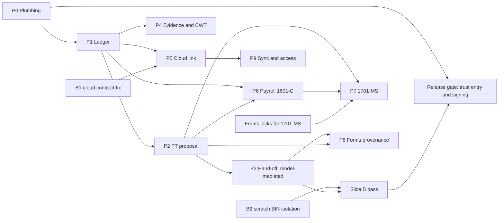

# 05 Implementation plan: phases P0 to P10

Status: plan, dated 2026-10-29. Writer: W3.
Read first: [01 architecture](01-architecture.md), [04 first slice](04-first-slice.md). Decisions and blockers: [07](07-decisions-and-blockers.md). Tests: [06](06-testing-plan.md).

Labels follow [01, How to read this file](01-architecture.md#how-to-read-this-file). Sizes are relative effort (S, M, L), not dates. Path roots are explained in [01 section 1](01-architecture.md#1-scope-evidence-and-repo-state).

---

## 1. Principles

1. **Slice first.** No phase starts until the previous phase's exit gate passes. Slice A and Slice B are the first gates.
2. **Trust last.** The packaged Rox `trust.json` entry ships only after A0 to A15 and B0 to B8 pass (D21). Until then, stage A uses a per-run trust file.
3. **Tax correctness gates.** No phase ships a number that a golden test has not checked. Known BK-TS defects are regression tests, not ports.
4. **No cross-repo writes from this repo.** BIR, Forms, Rox and buwiz-cloud changes are made by their owners in their repos (D22). This plan lists them.
5. **Money stays integer.** Every phase keeps the centavos rule (01 section 6.4).

## 2. Phase summary

| Phase | Name | Goal (one line) | Size | Exit gate | Cross-team |
|---|---|---|---|---|---|
| P0 | Plumbing | A signed `books` plugin installs and shows a neutral label | S | A1 | Rox owner (release only) |
| P1 | Ledger | Synthetic book with balanced entries, void, periods, tickets, idempotency, encrypted store | M | A2, A3, A4, A8, A9, A11 | None |
| P2 | PT proposal | Ready or blocked 2551Q proposal with lineage, rule sets, staleness | M | A5, A6, A7, A10, A14 | Forms owner (schema hash, D5, D6) |
| P3 | Hand-off (model-mediated) | Slice B passes on a scratch BIR profile | S | Slice B (B0 to B8), A15 | BIR owner (D12, D3); Forms owner |
| P4 | Evidence and CWT | Credits only from verified 2307 certificates. No plaintext payor TIN. | M | CWT golden tests, privacy scan | None (D23) |
| P5 | Cloud link | Book linked to an approved tax profile by opaque `id` | M | Link survives restart. No TIN in any output. B1 closed. | Cloud session (B1) |
| P6 | Payroll 1601-C | 1601-C matches Forms on synthetic payroll | L | Golden test fails on BK-TS behaviour, passes here | Statute check (RR CONFIRMED, statute UNVERIFIED) |
| P7 | 1701-MS | 1701-MS proposal matches Forms on synthetic data | L | Forms locks first. Golden match. | Forms owner (locks); owner (scope) |
| P8 | Forms provenance | `books` source, signed envelope, persisted provenance | M | Signed proposal accepted, no `user` label, provenance survives restart | BIR owner; Forms owner; owner (key, D2) |
| P9 | Sync and access | Per-book sync. Pass-based access. | L | Not defined yet | Cloud design; D15 |
| P10+ | Later forms | 2550Q (VAT), EWT and 1601-EQ, 1701Q | n/a | Not scheduled | n/a |

Release gate (not a phase): the trust entry and signed release for installed users. Owner: Rox owner. Condition: A0 to A15 and B0 to B8 pass (D21).

## 3. Dependency graph

Parallel work that is safe now: P0 with the design of P5, and P2 rules for graduated non-VAT. Start P1 once P0's plumbing works. P3 waits for B2 and D3.

## 4. Phase details

### P0 Plumbing (S)

- **Goal.** A signed `books` plugin installs in the real Rox host and shows a neutral label.
- **Deliverables.** Cargo workspace. `books-mini-app` with the reserved `rox.*` tools (`rox.provision`, `rox.session.open`, `rox.session.close`, `rox.ticket.resolve`, `rox.uninstall` `[rox §7]`). JCS manifest generator. `home` stub app. Signing run. Per-run trust file. Conformance run.
- **Files (this repo).** `Cargo.toml`; `crates/books-mini-app/src/main.rs`, `jsonrpc.rs`, `reserved.rs`, `jcs.rs`, `manifest.rs`, `apps.rs`; `apps/home.tsx`; `tests/`. `CLAUDE.md` is written by W1.
- **Files (Rox, release only).** `server/src/v1/trust.json:11-23` gets an `approved_plugins` entry. Packaging copies it at `server/tools/package-server.sh:54` `[V]`. Rox tests that cover trust and install get a `dev.goldcoders.books` case. The file that owns those tests is UNKNOWN; check `server/test/v1-plugins.test.mjs` and `v1-manifest.test.mjs` at release time. In stage A, nothing in Rox changes. The per-run file is set with `ROX_TRUST_FILE` (`server/src/v1/trust.mjs:14` [V]).
- **Conformance.** `rox-plugin-test` checks P3, P4 and P7 mechanically. It runs the broker's real v1 code in process with a temp trust store and never touches the Keychain or the broker data folder `[rox §9; sdk docs/testing.md]`. Its usage takes `--command`, `--args`, `--sign-with` or `--manifest` with `--key-file`, and `--keygen` `[rox-plugin-test.mjs header]`. Books runs its own tests in Rust.
- **Depends on.** Rox owner for release only. Publisher key owner (D9: reuse `gc-2026-01`).
- **Exit.** A1. Conformance P3, P4 and P7 pass.
- **Risks.** RK-5 (silent tool-name skip). RK-9 (spawn env is stored). RK-21 (first-party inline cards mount at once). RK-24 (short or command name collision). JCS drift: check the JCS output against Rox's `jcs-vectors.json` (`app/src/mini_v1/jcs-vectors.json`, `server/test/fixtures/jcs-vectors.json` `[rox §4]`).

### P1 Ledger (M)

- **Goal.** A synthetic book with COA, balanced entries, void and reversal, periods, tickets, idempotency, audit and an encrypted store. Ledger app works.
- **Deliverables.** COA preset data exported from BK-TS at `1662ca3` (data only, no code import). Entries and the balance check. Void by reversal. Periods with per-period locks. Ticket store. Idempotency table. Audit table. Encrypted store with key file. Ledger app.
- **Files (this repo).** `crates/books-core/src/money.rs`, `periods.rs`, `ledger.rs`; `crates/books-store/src/lib.rs`, `keyfile.rs`, `tickets.rs`, `migrations/0001_init.sql`, `repo/*.rs`; `crates/books-mini-app/src/tools/ledger.rs`, `coa.rs`, `tickets.rs`; `apps/ledger.tsx`; `data/categories.v1.json` (the `data/` tree is owned by W2 in the docs phase; this phase consumes it).
- **Files (other repos).** None.
- **Depends on.** Decision Q-1 (void rule, [01 section 7.6](01-architecture.md#76-void-rule-proposal-open-question-q-1)) before exit. D1 (neutral labels) before release. D2 (key custody) before release.
- **Exit.** A2, A3, A4, A8, A9, A11. Store checks in [06 section 5](06-testing-plan.md#5-store-and-restart-tests).
- **Risks.** RK-6 (void semantics). RK-7 (encryption build not proven; a cipher mismatch could silently store plaintext). RK-8 (key loss means ledger loss). RK-10 (titles are clear text in Rox). R-13 (neutral labels, D1). R-18 (retries double-post; fixed by `client_request_id`).
- **Do not port** from BK-TS: the org-wide `closedThrough` lock (`src/db/schema/auth.ts:92`, `[books §1 item 9]`), or any bill and invoice posting code. Only the COA data and the account numbers are reused.

### P2 PT proposal (M)

- **Goal.** A `ready` or `blocked` 2551Q proposal for 2026-Q3, with lineage, a pinned rule set, dated rate rows, a blocking matrix and staleness. Period and card apps.
- **Deliverables.** Tax facts. Rate table with dated rows (1% and 3%). 2551Q rule set. Blocking matrix (8%, VAT threshold, returns). Proposal row with `inputs_hash` and `output_sha256`. Lineage. Period app. `card-proposal` and `card-cash` cards (counts and status only, RK-21). Rule set and pinned schema copy.
- **Files (this repo).** `crates/books-core/src/pt_2551q.rs`, `rules.rs`, `fingerprint.rs`, `proposal.rs`; `data/rules/2551q-v2018.rules.json` (created here, data owned by W2 in the docs phase); `data/forms/2551q-v2018.json` (pinned copy with full SHA-256, `2551q` digest in [01 section 9.1](01-architecture.md#91-observed-constraints)); `apps/period.tsx`; `apps/card-proposal.tsx`. The crosswalk text is in [docs/03-crosswalk.md](03-crosswalk.md) (W2). The canonical design's separate `CROSSWALK-2551Q` file is folded into it.
- **Depends on.** Forms owner confirms the digests in [01 section 9.1](01-architecture.md#91-observed-constraints). B4 hashing is done in this write-up, but the owner's confirmation is still needed. D5 (8% conflict) for any 8%-year output. D6 (1% extension) for 2023-07-01 to 2025-12-31. Tax adviser review of the rule set before release.
- **Exit.** A5, A6, A7, A10, A14.
- **Risks.** RK-15 (PT accrual to ledger accounts 21800 and 94100 is not decided; BK-TS never posts them, `[books §3b]`). RK-16 (overdue return with no penalty computed, D14). RK-17 (8% election must come from Books' own store, never from the request; BK-TS reads it from the request `[verify §2 item 32]`). RK-22 (legal uncertainty for 8% and 1%). R-11 (rounding tie, D7).
- **Do not port** from BK-TS: `VAT_THRESHOLD` defined twice (`percentage-tax.ts:50`, `vat.ts:70`), the client-set 8% flag, the 1% window hard-coded at `percentage-tax.ts:65-68` (replaced by dated rows).

### P3 Hand-off, model-mediated (S)

- **Goal.** Slice B passes on a scratch BIR profile.
- **Deliverables.** `books_form_proposal_get`. `books_app_handoff_confirm` (app-only). `proposal` scope and attach. `bookform` app. Contract tests: every `fill_args` key is in the pinned bindings or the verified typed-alias list. Tie vector through the live cents helper.
- **Files (this repo).** `crates/books-mini-app/src/tools/proposal.rs`; `apps/bookform.tsx`; `tests/contract/bir_handoff.rs`, `tests/contract/schema_keys.rs`.
- **Files (BIR, live tree, by the BIR owner).** None for MVP (change 3 in [01 section 9.4](01-architecture.md#94-changes-needed)). Change 1 (confirm `document`) and change 2 (scratch install path) are decisions, not code.
- **Depends on.** B2 (scratch isolation, RK-1). D3 (source label). Forms owner for change 9 (rounding statement). BIR owner for D12.
- **Exit.** B0 to B8. A15.
- **Risks.** RK-1 (scratch isolation). RK-2 (a second broker may not be a supported setup; UNKNOWN). RK-11 (model sees amounts, needed to fill; privacy trade-off). RK-12 (provenance is session-only). RK-19 (BIR background writes can change the B0 checksum). R-4 and R-19 (label `document` means "uploaded OCR" to BIR). R-11 (f64 cents helper, `crates/bir-core/src/forms/form_2551q.rs:1467` [V]).
- **Stop.** Do not run any Slice B step against the live BIR database.

### P4 Evidence and CWT (M)

- **Goal.** Line 15 (creditable PT withheld) from verified 2307 certificates only. No plaintext payor TIN.
- **Deliverables.** Encrypted evidence store. Idempotent 2307 import. Credit only for status `received`. Payor HMAC for matching (D23), masked display only. `pick_file` permission.
- **Files (this repo).** `crates/books-store/src/evidence.rs`; `crates/books-core/src/cwt.rs`; `tests/golden/cwt/`.
- **Depends on.** D23. Nothing outside the repo.
- **Exit.** CWT golden tests, privacy scan (06 section 8), and the rule that only `received` credits.
- **Risks.** R-23 (evidence blobs and OCR text). `[books §4g]` a pending, lost or disputed certificate can post a receivable in BK-TS. WB084 is final and is never credited `[bir W-4]`. Routing WB to 2551Q line 15 is INFERENCE `[bir W-3]`. BK-TS period fields are text, not DATE `[books §2]`. Books uses DATE.
- **Do not port** from BK-TS: `postCwtReceivable` without a status check (`src/lib/tax/post-cwt-receivable.ts`, books §4g) and plaintext `payorTin` (`src/db/schema/tax-certificates.ts:47`).

### P5 Cloud link (M)

- **Goal.** Link a business to an approved tax profile by opaque `id`. The link survives restart.
- **Deliverables.** Device sign-in as client `buwiz-books`. `/me` (if needed). `GET /api/tax-profiles` read of `id`, `display` and `permissions` only. Link stored by `id`. Refresh-token rotation in the Books process. Refusal of TIN-shaped fields.
- **Files (this repo).** `crates/books-mini-app/src/cloud.rs`; `crates/books-store/src/session.rs`; `apps/home.tsx` (link UI).
- **Files (buwiz-cloud, owned by the cloud session).** `src/claims.rs:27` (`PROFILE_PERMISSIONS`: `filing.submit` must not reach `buwiz-books`). `src/claims.rs:410-433` (`tax_profiles` handler and `active_profiles`, at 9f5ee16: drop `tin` at line 429, `tin_masked` at 430, `registered_name` at 431 and `activated_at` at 432; `permissions` at 433 must match the contract; the approved filter is at 418). `README.md:74` (contract row). Also stop returning `tin` to `mcp`-scope tokens (F-50, Q-9). `src/oauth.rs:21` already registers `buwiz-books` `[V]`. `migrations/0001_init.sql:79` (`tin_claims.tin_root` plaintext: hash or encrypt, D18).
- **Depends on.** B1 (cloud contract drift). D13 (repo naming). D19 (sign-in optional).
- **Exit.** Link survives restart. No TIN in any Books store or output. B1 closed (the live response matches the decisions contract).
- **Risks.** RK-3 (live response has `tin`, `tin_masked`, `registered_name`, `activated_at`, and `filing.submit` for every client). Refresh token storage: Books process only, 0600 file or Keychain (decision Q-3 in 07). Approval withdrawn: id leaves the list, so the link must show inactive (`src/claims.rs:413` [V]).
- **Contract drift to record.** The decisions contract names the field `display`. The live code returns `tin_masked` `[V, README.md:74; claims.rs:430]`.

### P6 Payroll and 1601-C (L)

- **Goal.** A 1601-C that matches Forms on synthetic payroll, and that does not repeat BK-TS defects.
- **Deliverables.** Employee and employer components. Netting per RR 11-2018. MWE flags. Due dates (10th of the following month; December to 15 January; eFPS group day). Encrypted export. Per-run keys (scope to confirm: export encryption keys or Rox signing keys for the run).
- **Files (this repo).** `crates/books-core/src/payroll.rs`, `form_1601c.rs`; `tests/golden/1601c/`.
- **Depends on.** Owner or tax adviser confirms the statute text. RR 11-2018 is CONFIRMED, the statute is UNVERIFIED `[bir §3.4 item 19; verify §2 item 69]`. Forms 1601-C pin `07ca2f04da430efa...` `[01 section 9.1]`.
- **Exit.** The 1601-C matches Forms on synthetic payroll. The golden test fails on BK-TS behaviour (taxable 40,000 against 38,000 `[books §1 item 1]`) and passes here.
- **Risks.** RK-18 (employee share netting; BK-TS drops it). Semi-monthly payroll collides on the BK-TS key (`[books §1 item 8]`; live use UNKNOWN). Item 17 cap of ₱90,000 is configurable `[bir §3.4]`. Items 16 and 23 need sources UNVERIFIED `[bir §6]`.
- **Do not port** from BK-TS: `compensationFromPayrollLine` (`src/lib/tax/form-1601c.ts:52-109`) and the one-month-per-key upsert (`src/lib/tax/issue-1601c.ts:67-73`).

### P7 1701-MS (L)

- **Goal.** A 1701-MS proposal for a TY2025 scope check, with the election-locked fill and the correct 8% base.
- **Deliverables.** Spouse scope. 8% base includes other non-operating income. No ₱250,000 reduction for mixed earners. Election-locked fill. TY2025 scope check. Explicit statement of taxable year against filing year.
- **Files (this repo).** `crates/books-core/src/form_1701ms.rs`; `rules/ph/1701ms/v2024/rules.json` (path per canonical design; data owned by W2 in the docs phase).
- **Files (Forms, by the Forms owner).** `draft_locks.rs` gets the locks for items 12, 17 and II015 to II017 `[verify §1 item 3]`.
- **Depends on.** Forms locks land first (B7). Owner decision on scope: Annex C is TY2025 only (`[verify §2 item 80]`; TY2026 UNKNOWN).
- **Exit.** Proposal matches Forms on synthetic data. Locks are live before any 1701-MS fill.
- **Risks.** RK-22 (scope and TY2026 applicability). The 1701-MS 8% election fields are unlocked in Forms today `[verify §2 item 10]`. Printed rounding rule (49 centavos) is image-only `[verify §5]`.
- **Do not port** from BK-TS: nothing. BK-TS has no 1701 code `[books §1 item 2]`.

### P8 Forms provenance (M)

- **Goal.** BIR accepts a signed Books envelope with source `books`, and it persists per-box provenance across restart.
- **Deliverables.** `books` source. Signed envelope (01 section 9.3). Persisted per-box provenance. `bir_form_send` gated (already grant-gated in the live tree, but a standing grant has no expiry, RK-13). Forms cents statement (the half-away rule written down).
- **Files (BIR live tree, by the BIR owner).** `crates/bir-mcp/src/tools.rs:90` (`FILL_SOURCES`), `:309-311` (schema enum and description), `:547` (code default `ai`). `crates/bir-shell/src/agent/session.rs:1214-1249` (`fill_source`), `:55` and `:526` (provenance reset). `crates/bir-core/src/db/migrations.rs:112` (`form_drafts`) for a provenance column or table. Sign script unchanged unless a tool is added.
- **Files (this repo).** `crates/books-core/src/envelope.rs`.
- **Depends on.** BIR owner. Forms owner. Owner decision on the envelope key (D2, key custody). A BIR version bump is needed for an update to install `[bir-shell §6; manifest.rs:30]`.
- **Exit.** A signed proposal is accepted. No `user` label. Provenance survives a BIR restart.
- **Risks.** RK-12 (provenance). RK-14 (the model can claim `user` in some paths, `[bir-shell §8 item 2]`). Re-signing and version bumps for each BIR change.
- **Note.** The canonical design cited D6 for the envelope key. D6 is the 1% extension. The key decision is D2. See 07, Design corrections.

### P9 Sync and access (L)

- **Goal.** Later. Per-book sync, and access by pass or owner-signed delegation.
- **Deliverables.** Not designed. Constraints only: encrypted entries only, no TIN, grant model (D15).
- **Files.** A sync module in this repo. Cloud grants in buwiz-cloud. Neither is started.
- **Depends on.** buwiz-cloud has no organizations or passes in v1 `[decisions.md, cloud]`. D15.
- **Exit.** Not defined yet. A design doc comes first.
- **Risks.** Pass-based access needs cloud changes that v1 does not have. Books' firm tables are schema only and must not be reused unreviewed `[identity §2.6]`.

### P10+ Later forms (not scheduled)

2550Q (VAT, with reserved treatments `sale_vat`, `sale_zero_rated`, `sale_exempt`). EWT and 1601-EQ. 1701Q. Each is a separate proposal with its own rule set. Filer-type rules are in [01 section 10](01-architecture.md#10-accountants-and-other-filer-types-later).

## 5. Risk register

Two ID families appear in these docs:

- **R-n** IDs are the canonical design's. This plan uses only the ones the canonical design cites, with the meaning the design gives them: R-4, R-7, R-11, R-13, R-18, R-19, R-23. The full canonical register text was not supplied to this writer. A reviewer should merge it.
- **RK-n** IDs are added in this write-up. They cover risks found while reading the traces and the live trees.

| ID | Risk | Phase | Owner | Mitigation | Evidence |
|---|---|---|---|---|---|
| RK-1 | Installed BIR reads the live database by default. `BIR_DATABASE_PATH` is not in the installed env. | P3 | Rox owner, BIR owner | Second broker with its own data folder and trust file. Assert the scratch path before any call (B0). | `[rox §6]` env keys; `crates/bir-core/src/db/mod.rs:355-370` [V] |
| RK-2 | A second broker on another port and data folder may not be a supported setup. | P3 | Rox owner | Test it on a clean path first. If unsupported, use BIR's own harness (D12 option 2). | UNKNOWN (no test run) |
| RK-3 | Cloud contract drift. Live response has `tin`, `tin_masked`, `registered_name`, `activated_at`. Every client gets `filing.submit`. | P5 | Cloud session | Fix per D18 before P5. | `src/claims.rs:27, 410-433` [V]; `README.md:74` [V] |
| RK-4 | Refusal codes differ by path (`permission_denied` at Rox, `tool_error` from a plugin). | P1, P3 | Books | Treat all refusals the same. Test both (A12). | `bridge.rs:457` [V]; `sessions.mjs:300` [V] |
| RK-5 | Tool names that do not start with `books_` or that collide are skipped silently. | P0 | Books | Check names against the installed set. Test the list. | `server/src/v1/agent.mjs:65` [V] |
| RK-6 | Void semantics are unclear (original `posted` or `voided`). | P1 | Books, owner | Decide Q-1 before P1 exit. Test A4 under the chosen reading. | [01 section 7.6](01-architecture.md#76-void-rule-proposal-open-question-q-1) |
| RK-7 | Encrypted-store build not yet proven. A cipher mismatch could silently store plaintext. | P1 | Books | Build spike. Refuse on mismatch. Test with `strings`. | [01 section 6.2](01-architecture.md#62-store-design-proposal) |
| RK-8 | Key-file loss means ledger loss. No recovery is designed. | P1, release | Owner (D2) | Backup prompt. Passphrase option before release. | D2 |
| RK-9 | Spawn env is stored in the broker database. | P0 | Books | Paths only. Test the env at install. | `plugins.mjs:463` [V]; `[bir-shell §8 item 10]` |
| RK-10 | Rox keeps titles in clear text in `mini-v1.json`. | P0, P1 | Books | Neutral labels (D1). | `[rox §10]` |
| RK-11 | Tool results carry amounts (needed to fill). A privacy trade-off. | P3 | Owner | Keep to the proposal's values. No TIN, no Books IDs. Scanner. | INFERENCE |
| RK-12 | BIR provenance is session-only and resets on restart. User-box protection goes with it. | P3, P8 | BIR owner | Re-read every value after a BIR restart before confirm. P8 persists it. | `[verify §3]`; `session.rs:55, 526` [V] |
| RK-13 | `bir_form_send` is live. An "allow once" grant can outlive the process. Standing grants have no expiry. | Before live use | BIR owner | Books never calls it. Gate or remove it (change 4). | `[bir-shell §8 item 1]`; `session.rs:1388-1400` [V] |
| RK-14 | BIR accepts `source: user` with `from_card` for card keys. The model could claim it. | P8 | BIR owner | Books never sends `user`. Later BIR change. | `[bir-shell §8 item 2]` |
| RK-15 | Whether Books posts the PT accrual (21800 and 94100) is not decided. BK-TS never posts them (ten of 21 PH accounts are unposted). | P2 | Owner | Open question Q-2 in 07. Decide at P2 exit. | `[books §3b]`; `[verify §2 item 37]` |
| RK-16 | An overdue return shows no penalty. Users may read the card as "nothing owed". | P2 | Books | Show "no penalty computed" next to the due date. | D14 |
| RK-17 | BK-TS reads the 8% election from the request, not from storage. | P2 | Books | Books reads only its own election record. A test sends a conflicting request value and expects it ignored. | `[verify §2 item 32]`; `[books §1 item 4]` |
| RK-18 | BK-TS drops employee contributions in 1601-C. | P6 | Books | Golden test fails on BK-TS behaviour. | `[books §1 item 1]`; `[verify §2 item 28]` |
| RK-19 | BIR may write in the background. The B0 checksum can change with no Books call. | P3 | BIR owner | Compare table-level checksums in the scratch profile, or stop BIR for the live check. | UNKNOWN (background writes not checked) |
| RK-20 | The running broker may not match the perf-parity source. | Release | Rox owner | Verify the running bundle before release. | `[rox §10]` UNKNOWN |
| RK-21 | First-party publisher inline cards mount without a click. | P0 | Books, owner (D9) | Counts and status only on inline cards. | `plugins.mjs:737` [V]; `[rox §5 stage 9]` |
| RK-22 | Legal uncertainty: 8% and 2551Q conflict (D5), 1% extension (D6), RR 8-2018 text not read, Annex C is TY2025 only. | P2, P7 | Tax adviser, owner | Block (D5). Warn only (D6). Obtain primary text. | `[verify §2 items 63, 73, 80, 84]` |
| RK-23 | Books' rule set drifts from the pinned Forms schema. | P3 | Forms owner | Hash check at start-up. Contract tests. | `[verify §2 item 3]` |
| RK-24 | `books` short name or command name collides with another enabled plugin. | P0 | Books, Rox owner | Check at install. Rename rule per `[bir-shell §6]` (`plugins.mjs:421-429`). | `[rox §7]` |
| R-4 | Label accuracy. `document` means "uploaded OCR" to BIR. | P3 | Forms owner, BIR owner | Decide D3. Keep `document` for MVP. | `tools.rs:309-311` [V]; D3 |
| R-7 | Send grant and allow-once path. | Before live use | BIR owner | Change 4. | `[bir-shell §8 item 1]` |
| R-11 | Half-away rounding on the PT line. f64 input can move a tie. | P3 | Forms owner | Golden tie test through the live helper. Test fails unless 1.50 at 3% gives 0.05. | `form_2551q.rs:1467` [V]; D7 |
| R-13 | Books titles or cards carry legal names or amounts. | P0, P1 | Books | Neutral labels only (D1). | `[rox §10]`; `[bir-shell §10]` |
| R-18 | Retries double-post. | P1 | Books | `client_request_id` on every write (A9). | `[books §1 items 2, 6]` |
| R-19 | Same as R-4 for the source label. | P3 | Forms owner | As R-4. | D3 |
| R-23 | Evidence and OCR text stored in the clear, or sent to a model. | P4 | Books | Encrypted blob. Model gets sha256 and kind only. | PROPOSAL |

## 6. Sequencing and handoffs

| Handoff | From | To | When | What is handed over |
|---|---|---|---|---|
| Trust entry | Rox owner | Rox release | Release gate | Entry for `dev.goldcoders.books` (after A0 to A15, B0 to B8) |
| Client registration | Cloud session | Cloud | Before P5 | `buwiz-books` client already in `src/oauth.rs:21` `[V]`; contract fixes (B1) |
| Scratch BIR path | BIR owner | Books | Before P3 | Confirmed scratch install recipe (B2) |
| Source label | Forms owner | Books | Before P3 | Confirmed label for `document` (D3) |
| Forms locks | Forms owner | Books | Before P7 | Locks for 1701-MS items 12, 17, II015 to II017 `[verify §1 item 3]` |
| Signing key | Owner | Books | Before P8 | Books public key pinned in BIR; private key custody (D2) |
| Tax review | Tax adviser | Owner | Before P2 release, P6 release | RR 8-2018 text, 1% extension primary text, statute for 1601-C item 19 |

## 7. Definition of done per phase

A phase is done when:

1. Its exit IDs pass in the test tier named in [06](06-testing-plan.md#11-test-tiers).
2. No new float appears in money code (a CI check).
3. The privacy scanner passes on the phase's outputs.
4. Its decisions are recorded in [07](07-decisions-and-blockers.md) or an ADR.
5. The checks run. This repo is Rust, so the proposed gates are `cargo fmt --check`, `cargo clippy` and `cargo test` ([06 section 11](06-testing-plan.md#11-test-tiers)). The `bun check` gate in BK-TS does not apply here. The repo's own `CLAUDE.md` (W1) sets the final commands.
