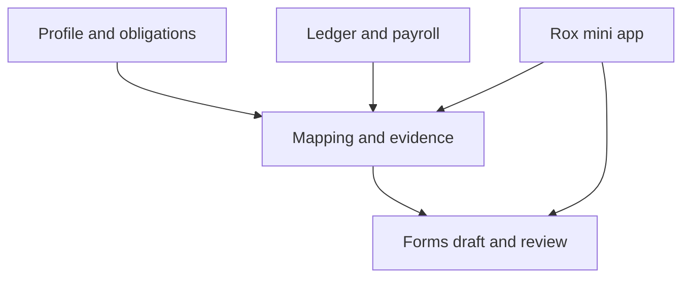

# Handover: investigate a Buwiz Books mini app in Rox

Prepared for a follow-on investigation with Claude · Research snapshot: 28 October 2026

## 1. What the owner wants

The owner has **Buwiz Forms**, **Buwiz Books**, and **Rox**. A Buwiz mini app already exists in Rox. They want to understand how to build a **Buwiz Books mini app** in that existing environment and connect bookkeeping with tax-return preparation.

The starting idea is:

1. A taxpayer has a tax profile, a Certificate of Registration (COR), registered tax types, and a set of relevant BIR forms.
2. Buwiz suggests a useful chart of accounts and bookkeeping categories based on that profile, the forms, and ordinary accounting needs.
3. Transactions, payroll, supporting documents, and tax attributes are recorded and reviewed in Books.
4. The appropriate information can be traced from Books to the right fields in a Buwiz Forms draft, so a person can review and prepare a return.

The initial concrete example is an individual with **2551Q**, **1601-C**, and **1701-MS**. Eventually the design should cover other individuals and entities, including corporations and partnerships. The COR and selected forms are useful inputs, but the product also has to account for effective dates, actual taxpayer facts, elections, changes in registration, and exceptions. Do not equate “individual” with “every individual form applies,” or “corporation/partnership” with one universal form bundle.

**Assignment:** investigate how this can fit the existing products. Trace the running Buwiz mini app and relevant code before recommending architecture or implementation. Explain what exists, what is partial, and what is missing. Produce a concrete, prioritized, build-ready plan for a usable Books mini app, including a small end-to-end first slice. A local proof of concept using synthetic data is welcome if it is needed to verify an integration; do not deploy, alter real financial data, submit returns, or make assumptions about authority to act on production accounts.

This is a product and engineering investigation. The spreadsheets and the observations below are research inputs—not a replacement for current source code, current BIR rules, or a tax professional's review of a production filing.

## 2. Attachments to read

The owner plans to attach these files in the Claude conversation:

| Attachment | Use | Limitation |
|---|---|---|
| `Buwiz_Books_Rox_Claude_Handover.md` | This investigation brief and preliminary repo map. | File paths and observations are dated; verify the current branches and actual running deployment. |
| `Buwiz_Tax_Profiles_Categories_Form_Fields.xlsx` | Primary research artifact: taxpayer profiles, candidate category catalog, category-to-field rules, form fields, a worked example, and implementation notes. | Detailed field inventories focus on 2551Q, 1601-C, and 1701-MS; the wider form catalog is a starting inventory, not a complete implementation. Category IDs and human-readable field labels are not automatically the apps' API keys. |
| `Philippine_Bookkeeping_and_BIR_Form_Map.xlsx` | Background explanation of accounting/bookkeeping, typical form combinations, and how information flows to returns. | Educational and illustrative, not an exhaustive or filing-ready crosswalk. |

In the main workbook, begin with `Profile`, `Category catalog`, `Category field rules`, the three `… fields` tabs, `Worked example`, `Example data`, and `Build notes and sources`. Read formulas and referenced cells as well as displayed values. Preserve and investigate uncertainty rather than importing every row into the product unchanged. Recheck field versions, scope, signs, conditions, and official sources.

If attachments or code access are unavailable, say exactly what is missing; investigate everything else that is accessible and specify the smallest access needed to finish. Do not infer that you can see the user's local application simply because the repository is public.

## 3. Repositories and preliminary evidence

The following are **navigation leads from a preliminary read**, not a complete audit. Check the actual checkout, branch, commits, `AGENTS.md`, runtime, and deployment before treating them as current. Evidence was sampled from these GitHub heads:

| Project | Observed head | Starting point |
|---|---|---|
| [Buwiz Books](https://github.com/hexuria/buwiz-books) | [`1662ca3`](https://github.com/hexuria/buwiz-books/commit/1662ca37404ccc6c270ad48888eda3505ec45165) | Bookkeeping and tax logic; TypeScript, Bun, TanStack Start, PostgreSQL/Drizzle in the inspected tree. |
| [Buwiz Forms](https://github.com/hexuria/buwiz-forms) | [`63267ca`](https://github.com/hexuria/buwiz-forms/commit/63267ca3d4d526a8ec490394470f026de82ac385) | Rust/GPUI forms application, form schemas, draft logic and BIR MCP integration. |
| [Rox](https://github.com/hexuria/rox) | [`e3cdc18`](https://github.com/hexuria/rox/commit/e3cdc18215c5a803a4c69324c917111d5e1513e7) | Native host and mini-app protocols; inspect the actual installed Buwiz mini app too. |
| [Buwiz Server](https://github.com/hexuria/buwiz-server) | [`417ec3a`](https://github.com/hexuria/buwiz-server/commit/417ec3ae82e19835ce7452a180c31fb2b70c573c) | Potentially relevant identity, tax-profile and authorized-access contracts; establish whether the target deployment uses it. |

**Important open question:** the preliminary inspection found Rox's mini-app host and references to a BIR plugin, but did not establish the source and manifest of the user's **currently installed Buwiz mini app**. Locate that actual plugin, its source, configuration, and backend. They may live in another repository or deployment. Do not assume the existing mini app is missing or create a replacement based on host test fixtures.

### Rox: start from the real host and plugin

- [`app/src/mini.rs`](https://github.com/hexuria/rox/blob/e3cdc18215c5a803a4c69324c917111d5e1513e7/app/src/mini.rs) is a useful entry point. Inspect `app/src/mini_v1/`, including `host_api.rs`, `perms.rs`, `storage.rs`, `bridge.rs`, `links.rs`, `lifecycle.rs`, and tests, along with the actual plugin manifest and app source.
- The inspected host has both a v0 path and a v1 mini-app protocol, with different boundaries. V1 includes declared capabilities, a bridge, app storage, and session/link handling. Find out which version the actual Buwiz mini app uses and what is enabled in the deployment; do not apply one version's assumptions to the other.
- Trace discovery/registration → open/install → launch/session → UI rendering → tool or backend call → results/errors → close/reopen. Identify the minimal manifest, SDK, build/package, distribution, permission, and authentication changes needed for Books. Determine whether to extend the installed Buwiz app or add a separate mini app; compare both against the real UX and runtime constraints.
- This is a native Rust/GPUI and mini-app environment. Do not assume a conventional browser/webview or that the TypeScript Books app can simply be embedded without checking the host's actual supported UI and execution model.

### Buwiz Books: reuse existing bookkeeping and tax capabilities

- Inspect [`src/db/schema/accounts.ts`](https://github.com/hexuria/buwiz-books/blob/1662ca37404ccc6c270ad48888eda3505ec45165/src/db/schema/accounts.ts), `src/db/schema/journals.ts`, `src/db/schema/payroll.ts`, `src/db/schema/tax-reference.ts`, and `src/db/schema/tax-stage-remainder.ts`. The inspected tree has organization-scoped accounts, journal headers/lines and payroll/tax structures. Verify posting, reversals, period boundaries, and status filters in the actual services.
- Inspect `src/lib/tax/ph-chart.ts`, `src/lib/coa/presets/philippines-smb.ts`, and `src/lib/tax/ph-account-resolver.ts` before proposing categories. Existing Philippine account keys and numbers should be reused when they fit; distinguish a preset key from a particular organization's database account ID. The resolver discusses consequences of introducing a new mapping type into shared category-mapping completeness checks—investigate that before extending it.
- Inspect `src/lib/tax/percentage-tax.ts`, `src/lib/tax/form-1601c.ts`, `src/lib/tax/filing-workspace.ts`, `src/lib/tax/filing-snapshot.ts`, and their tests. The `ComputedReturnForm` union inspected in `src/db/schema/tax-stage-remainder.ts` includes `2550Q`, `2551Q`, `1601C`, `1601EQ`, `0619E`, `QAP`, and `SLSP`; it does not list `1701-MS`. That observation alone does not prove there is no 1701-MS support anywhere else.
- Determine what the mini app may call through existing APIs/services, what must be exposed, whether Books is running locally or remotely, and how it would work offline. Avoid duplicating the ledger or treating the spreadsheets as the source of accounting truth.

### Buwiz Forms: use actual forms and draft contracts

- Inspect `crates/bir-core/src/tax_profile/` for the taxpayer/branch/year/form model and how COR data and elections are represented; verify which service owns each value.
- Inspect the versioned JSON schemas under [`crates/bir-core/data/agent-forms/`](https://github.com/hexuria/buwiz-forms/tree/63267ca3d4d526a8ec490394470f026de82ac385/crates/bir-core/data/agent-forms), especially `2551q-v2018.json`, `1601c-v2018.json`, and `1701ms-v2024.json`; examine typed drafts, form registry, validation, calculation, and tests. The workbook's human field identifiers need a verified crosswalk to the actual schema and transport.
- Inspect `crates/bir-core/src/integration/models.rs` and `mapper.rs`. In the inspected mapper, the active `FormDraftOutput` route is 2551Q; other routes in that file were placeholders/commented. Confirm current support across the entire codebase before deciding what needs to be built. The 2551Q mapping needs an explicitly established ATC; do not infer an ATC solely from a generic income category.
- The inspected `crates/bir-mcp` exposes a bounded set of BIR draft tools. Trace `bir_form_open`, `bir_form_fields`, `bir_form_context`, `bir_form_fill`, `bir_form_validate`, `bir_form_review`, and `bir_form_save_draft` and their real schemas. The allowed field provenance/source values and locked/computed fields are contract rules; do not invent a `bookkeeping` source value. Preserve user-entered values and review/error behavior.
- The `integrations/opengrok/bir/` integration documents app discovery, connection and real-database confirmation. Treat this as a specific integration surface, and verify if it is the one used by the running Rox mini app. The separate [`hexuria/bir-mcp`](https://github.com/hexuria/bir-mcp) repository may also be relevant; do not conflate it with `crates/bir-mcp` without tracing the installed system.
- The sampled MCP integration is draft-oriented. Separately, the Forms head contains work for queued agent filings, conditional on configuration and authorization. Investigate those pathways if relevant; do not assume that a draft tool's limits describe every pathway in the entire product. The proposed Books first slice should stop at a reviewable draft unless the owner later requests a broader workflow.

### Identity and authorization

Inspect the existing Buwiz Server and Forms identity/access paths when the target environment uses them. `buwiz-server`'s `src/contracts/tax_profile.rs` exposes a stable server-issued tax-profile ID and a masked TIN representation in the sampled contract; inspect actual permissions, opt-in access passes, organization and filing controls as applicable. Resolve the real mapping among authenticated user, firm, client, organization, taxpayer, branch, Books account and Forms profile. These may not have a one-to-one relationship.

An accountant may act for multiple clients, with explicitly granted access; the same person may use their own account. Honor existing authorization and revocation rules. Avoid putting raw TINs, credentials, or private financial records into deep links, logs, shared tickets, or app-local caches. Verify real enforcement and app-storage isolation with code/tests rather than inferring guarantees from naming alone.

## 4. Investigation questions

Answer with repository paths, relevant functions/types, and observed behavior. Mark each answer **confirmed**, **partly implemented**, **missing**, or **unknown**.

1. **Existing mini app:** Where is the live Buwiz app defined and installed? Which Rox protocol, SDK, plugin ID, manifest, tool registrations, UI components and backend does it use? Can the target environment launch it? What does a successful and a denied call look like?
2. **User journey:** How does a user currently select an organization, taxpayer/branch and year, see COR/registered forms, and switch clients? Where should Books be discovered in Rox? Can users enter/categorize transactions and see financial evidence in the mini app, or should it direct them to existing Books screens? Compare the available options.
3. **Truth and integration:** Which actual service owns the chart and ledger, tax profile and elections, form metadata, form draft, validation and history? Where do IDs, authorization, session state, and period selection cross app boundaries? What is the supported API or IPC path? What happens if one service is offline?
4. **Accounting to tax:** How are posted lines, accounts, taxes, dates, counterparties, receipts, credits and payroll stored today? What additional attributes are needed to support more than one tax form without assigning a single permanent tax meaning to every account?
5. **Tax forms:** Which relevant fields can be filled from ledger records, payroll, documents, profile/elections, prior payments, or other evidence? Which are computed, user-supplied, external, unsupported, repeated per row/person, or require review? Which forms and versions really exist today?
6. **Data and review:** Can the user see the source entries behind each proposed amount? How are missing data, ambiguous mappings, altered source records, prior drafts, period lock, rounding, and user overrides handled? How are snapshots preserved for a later amendment?
7. **Practical implementation:** What can be reused now? What must be implemented in Rox, Books, Forms, or a shared adapter? What is the smallest coherent slice that runs in the real host? What setup, dependencies, tests and migration risks does it have?

Include a comparison of extending the current Buwiz mini app versus a distinct Books mini app, and of reusing existing service interfaces versus introducing an adapter. Pick a recommendation based on actual code and development cost; do not prescribe a rewrite or a new hosting platform without evidence.

## 5. Candidate design to test against the code

The following is a **hypothesis**, not an imposed design:

The chart of accounts should remain useful for ordinary financial statements, including assets, liabilities, owner equity, income, and expenses. Form-specific reporting should be **many-to-many** and conditional: the same entry can contribute to multiple relevant reports or forms, while the same account can contain entries with different tax treatment. The user's form list can enable appropriate **suggestions**; it should not erase essential accounts or decide all tax treatment automatically. Users need a way to add, rename, disable, and map categories within the existing account/preset rules.

For each proposed tax contribution, investigate whether the system can store or derive: stable source entry/line IDs; authorized taxpayer and branch; relevant business and tax period; amount and sign; currency; document/certificate references; tax type and applicable ATC; treatment/exemption; counterparty/person; mapping rule and effective version; and a completeness or review status. Some of these will belong on a line, payroll item, document, profile, or mapping rule rather than on a general ledger account. Model each in its existing proper home.

For field mapping, distinguish at least **form code, form edition, period, field key, schedule/repeated row, taxpayer versus spouse or employee when relevant, tax type, effective rule, and source scope**. Track the contributing records and rule version used for a reviewable draft or snapshot. Make repeated generation idempotent, avoid double counting reversals and credits, and detect stale data or changed rules. Use exact decimal or integer-centavo representations across boundaries; investigate conversion and rounding where existing contracts use `f64`.

Keep the roles of ledgers, tax classifications, calculated tax values, evidence, profile questions, and field identities separate. A draft total calculated by Forms may have a dependency on mapped input fields; don't directly overwrite a computed, locked, or user-authored field merely because the workbook displays it.

## 6. Concrete field-mapping leads

These are **examples to verify** against the exact form version, current `bir_form_fields` response, adapter and mutability. The labels on the left are workbook shorthand. JSON bindings and typed paths below were observed in the Forms source; they are not a guarantee that the JSON binding string is the API input key.

| Example | Workbook label | Observed Forms binding | Observed draft path |
|---|---|---|---|
| 2551Q taxable amount, first schedule row | `2551Q S1.1.base` | `txtATCAmt1` | `/schedule_1/0/taxable_amount` |
| 1601-C total compensation | `1601-C II.14` | `frm1601c:txtTax14` | `/tax_14_total_compensation` |
| 1601-C employee contributions field | `1601-C II.19` | `frm1601c:txtTax19` | `/tax_19_sss_gsis` |
| 1701-MS taxpayer sales under the relevant schedule | `1701-MS IV.5` | `frm1701MS:txtSalesRevenueNo5a` | `/taxpayer/sales` |
| 1701-MS taxpayer 8% sales | `1701-MS IV.19` | `frm1701MS:txtSalesRevenuesFeesANo19a` | `/taxpayer/eight_sales` |

For the 1701-MS sales field, the spouse has a separate binding/path in the sampled schema; include person scope when applicable. One-based printed schedule row numbers can map to zero-based internal arrays. Do not assume all fields are fillable or that a return's form version is unchanged. The 1601-C contributions field covers more than just SSS/GSIS despite its shortened internal identifier; verify the current BIR instructions and actual payroll flow.

Use the workbook's fictional example as a candidate fixture, after validating assumptions:

- **2551Q:** Q3 sales of ₱300,000 less an eligible ₱10,000 return give a ₱290,000 base; the example's 3% PT010 produces ₱8,700 before credits.
- **1601-C:** September gross compensation ₱42,000, exempt de minimis ₱2,000, and employee mandatory contributions ₱2,000 yield example taxable compensation ₱38,000. Trace employee versus employer contributions and the correct payroll period.
- **1701-MS:** The workbook's separate full-year example uses ₱1,190,000 net sales and 40% OSD; inspect the input rows, income-tax credits and prior payments before asserting the result. The Q4 data is hypothetical, and the employer's 1601-C is not the taxpayer's own compensation return.

Percentage-tax withholding/credits on 2551Q are distinct from creditable **income-tax** withholding used in an income-tax return. Do not route one credit to both forms without explicit legal and source evidence. Account for actual tax dates, recognition rules, applicable certificate, and prior payment evidence.

## 7. High-priority checks

- **Payroll contributions:** In the sampled `form-1601c.ts`, `compensationFromPayrollLine` accepts several compensation inputs, while the inspected helper did not obviously aggregate employee SSS/PhilHealth/Pag-IBIG/union contributions into returned non-taxable compensation. Those shares appear in the payroll schema. Trace the complete path and existing tests before calling this a bug; if missing, identify the exact place and necessary meaningful test. Do not include the employer share in the employee field.
- **8% election and percentage tax:** The sampled `percentage-tax.ts` blocks a 2551Q calculation when `electedEightPercent` is true. Check effective-year rules, registration history, mixed income, threshold breaches, and transitional obligations before concluding that every 8% election makes every 2551Q invalid. Verify current authoritative rules; do not encode an overbroad assumption.
- **Money:** `crates/bir-core/src/integration/models.rs` uses `f64` in sampled payloads. Trace how books, draft serialization, and forms handle precision and rounding before prescribing a boundary representation.
- **COR and eligibility:** A COR form list is a starting input, not proof a return is due for every period or that the election/rate is valid. BIR's 2026 annual-return FAQ says eligible micro and small taxpayers can choose the 1701-MS manual return even if it is not shown on their COR. Compare actual obligations and available options with registrations, changes, filing year, legal exceptions and profile confirmation. Confirm current guidance for the relevant year.
- **Scopes and consent:** Confirm that cross-client reads and writes enforce the actual system's organization, taxpayer, branch, permissions, user confirmation and access-pass model. Treat unknown authorization as a blocker to accessing that real data.

## 8. Coverage and tests

Do not promise a complete list of “all possible permutations” as a finite hard-coded table. Build or propose a versioned, extensible coverage matrix of **taxpayer type × registration/election × period × form × source × readiness**, identifying unsupported or special cases. Start with the three detailed form dictionaries. Investigate 1701Q, corporate/partnership income returns such as applicable 1702 variants, VAT 2550Q, withholding 0619E/1601-EQ, and relevant schedules as future extensions only after checking their actual applicability and implementation. Design for new form editions and regulatory updates.

At minimum, recommend tests for:

1. A synthetic individual with 2551Q + 1601-C + 1701-MS, including the workbook example and exact form-version/field crosswalk.
2. An 8% election case, mixed-income/threshold-change case, and a case where the registered form list and actual obligation need review; do not silently assign or suppress a form.
3. A corporation or partnership profile routed only to applicable supported forms; indicate where coverage is missing.
4. One entry contributing to multiple forms under distinct rules, one account with different tax treatments, a reversal/credit note, and a repeated or spouse field.
5. A legitimate non-withholding-credit, an income-tax certificate, missing supporting evidence, correct employee/employer share, exact rounding and different tax periods.
6. No access to another client's ledger; consent revoked; missing permissions; isolated mini-app storage; no sensitive data in links; offline/error and safe retry.
7. A changed ledger entry or mapping rule after draft creation, stale detection, rerun without duplicate amounts, preserving user edits, snapshot reproducibility and amendment workflow.

Use existing tests and actual contracts where possible. Distinguish a unit-level mapper check from an end-to-end test that launches the actual host/app and crosses authorized service boundaries. Label simulated checks when the live runtime cannot be exercised.

## 9. Expected output from Claude

Deliver an investigation that another engineer can implement:

1. A short explanation of the proposed user journey, in plain language.
2. An evidence table for Rox, the current Buwiz mini app, Books, Forms, and any server/other service: **exists / partial / missing / unknown**, with exact paths, relevant methods, and observed commit or environment.
3. A traced current flow and a proposed Books mini-app architecture, including discovery, UI, authentication, service boundaries, IDs, persistence, permissions, offline behavior and source of truth. Note alternatives and why the recommendation fits the code.
4. A form-to-accounting model and a crosswalk for the three example forms showing which fields can be populated, computed, require user input or lack evidence; identify current-version API keys and unresolved discrepancies.
5. A recommended smallest end-to-end vertical slice and acceptance criteria, followed by prioritized implementation phases, likely files/modules to change, dependencies and migration considerations. 2551Q is a candidate because a mapper exists; choose only after tracing the actual system.
6. A test/verification plan with a synthetic example, meaningful failures, authorization, review, precision, and snapshots. State which tests were actually run and their results; call out environment limitations.
7. A concise list of decisions or access blockers that genuinely require the owner's input. Continue independent investigation rather than stopping for routine choices.

Separate **facts observed in current code**, **inferences**, and **proposed work**. If the actual mini-app repository, live runtime, or an attachment cannot be accessed, do not fill the gap with imagined APIs. Identify the missing source and the resulting uncertainty.

## 10. Source material and verification references

- BIR [2551Q return, January 2018 edition](https://bir-cdn.bir.gov.ph/local/pdf/2551Q%20Jan%202018%20ENCS%20final.pdf).
- BIR [1601-C return, January 2018 edition](https://bir-cdn.bir.gov.ph/local/pdf/1601C%20final%20Jan%202018%20with%20DPA.pdf).
- BIR [1701-MS return, August 2024 edition](https://bir-cdn.bir.gov.ph/BIR/pdf/1701-MS%20August%202024%20Fillable_01.pdf) and [instructions](https://bir-cdn.bir.gov.ph/BIR/pdf/RMC%20No.%2034-2025%20Annex%20A.pdf). Confirm the current official edition for the filing year.
- BIR [2026 annual-return questions and answers, including 1701-MS and COR](https://bir-cdn.bir.gov.ph/BIR/pdf/RMC%2020-2026%20Annex%20C%20%283%29.pdf).
- BIR [Revenue Regulations No. 8-2018](https://bir-cdn.bir.gov.ph/BIR/pdf/RR%20No.%208-2018.pdf) for the underlying 8% framework; verify later amendments, current thresholds and transition rules before implementation.
- The workbook's `Build notes and sources` and field tabs contain additional research references. Reconcile them with the live application and current official BIR guidance.

When repository behavior and a tax-law interpretation disagree, report the discrepancy and its evidence. Do not silently choose whichever makes implementation easiest.
